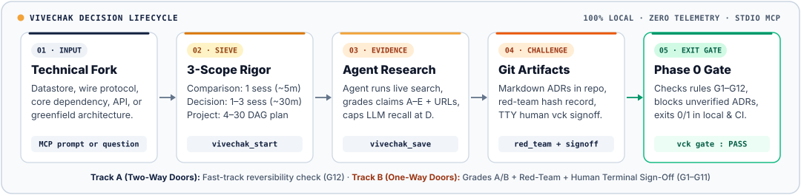

<p align="center">
  <picture>
    <source media="(prefers-color-scheme: dark)" srcset="docs/assets/logo-dark.svg">
    <source media="(prefers-color-scheme: light)" srcset="docs/assets/logo.svg">
    
  </picture>
</p>

<h1 align="center">
  Vivechak &nbsp;&middot;&nbsp;
  <picture>
    <source media="(prefers-color-scheme: dark)" srcset="docs/assets/wordmark-dark.svg">
    <source media="(prefers-color-scheme: light)" srcset="docs/assets/wordmark-light.svg">
    
  </picture>
</h1>

<p align="center">
  <strong>Evidence-graded technical decisions for AI coding agents — researched, challenged, and gated in Markdown before you write code.</strong>
</p>

<p align="center">
  <a href="https://github.com/bhaskarjha-dev/vivechak/actions/workflows/ci.yml"></a>
  <a href="https://vivechak.bhaskarjha.dev"></a>
  <a href="https://vivechak.bhaskarjha.dev/docs"></a>
  <a href="go.mod"></a>
  <a href="docs/MCP-TOOLS.md"></a>
  <a href="LICENSE"></a>
</p>

<p align="center">
  <a href="https://vivechak.bhaskarjha.dev"><strong>🌐 Website</strong></a> &nbsp;&middot;&nbsp;
  <a href="https://vivechak.bhaskarjha.dev/docs"><strong>📖 Docs</strong></a> &nbsp;&middot;&nbsp;
  <a href="https://vivechak.bhaskarjha.dev/playground"><strong>🎮 Playground</strong></a> &nbsp;&middot;&nbsp;
  <a href="#quickstart">Quickstart</a> &middot;
  <a href="#why-vivechak">Why Vivechak</a> &middot;
  <a href="#three-scopes">Three Scopes</a> &middot;
  <a href="#what-lives-in-research">Artifacts</a> &middot;
  <a href="#mechanical-gate-proof">Phase 0 Gate</a> &middot;
  <a href="#mcp-surface--cli">MCP &amp; CLI</a>
</p>

<p align="center">
  <picture>
    <source media="(prefers-color-scheme: dark)" srcset="docs/assets/workflow-dark.svg">
    <source media="(prefers-color-scheme: light)" srcset="docs/assets/workflow-light.svg">
    
  </picture>
</p>

> [!TIP]
> **Experience Vivechak Interactively &mdash; [vivechak.bhaskarjha.dev](https://vivechak.bhaskarjha.dev)**  
> Explore the framework before installing: test research scoping in the **[Playground](https://vivechak.bhaskarjha.dev/playground)**, generate 1-click host configs for Cursor/Claude/VS Code, simulate the **[Phase 0 Gate](https://vivechak.bhaskarjha.dev/#gate)**, or search the full **[Live Documentation](https://vivechak.bhaskarjha.dev/docs)** with keyboard shortcut `⌘K`.

---

## Why Vivechak

When you work with an AI coding agent (Claude Code, Cursor, VS Code, Antigravity, Windsurf, Zed, OpenCode, Goose) and hit a choice that is expensive to undo — a primary datastore, wire protocol, core dependency, public API, or security boundary — asking the agent directly gets an answer from training memory, with no verifiable citations, no rejected alternatives, and no record in Git.

**Vivechak** (`vck`, also installed as `vivechak`) is a local-first Model Context Protocol (MCP) server and CLI that puts an evidence-graded decision step **before** implementation:

| Tool Category | What It Gives You | What Is Missing |
|---|---|---|
| **Deep-research chat** | One-off narrative essay in a browser tab | Lives outside Git; nothing validates claims or gates code |
| **ADR templates** *(MADR, log4brains)* | Empty Markdown skeleton | Doesn't structure or grade the research behind the decision |
| **Spec kits** *(GitHub Spec Kit)* | Task breakdown for implementation | Starts *after* architectural choices are already assumed |
| **Vivechak (`vck`)** | **Graded research + ADRs + Phase 0 Gate in `research/`** | Your agent searches the web; Vivechak structures, challenges, and gates the trail next to your code |

---

## Quickstart

```sh
# 1. Install vck + vivechak (macOS / Linux)
curl -fsSL https://raw.githubusercontent.com/bhaskarjha-dev/vivechak/main/install.sh | sh

# 2. Register the MCP server in your AI host (auto-detects workspace or target a preset)
vck setup               # auto-detects workspace host, or pass: claude-code, cursor, vscode, claude, agy, windsurf, zed, roo, opencode, goose

# 3. Ask your coding agent a technical choice:
#    "Use Vivechak to compare Pino and Winston for our high-throughput Node.js service."
#    "Use Vivechak to decide whether to migrate event storage from PostgreSQL to ClickHouse."

# 4. Check workspace integrity & run the pre-code exit gate (exits 1 on FAIL; CI-ready)
vck doctor
vck gate
```

### Installation Channels

| Environment | Install / Run Command |
|---|---|
| **macOS / Linux Shell** | `curl -fsSL https://raw.githubusercontent.com/bhaskarjha-dev/vivechak/main/install.sh \| sh` |
| **Windows PowerShell** | `irm https://raw.githubusercontent.com/bhaskarjha-dev/vivechak/main/install.ps1 \| iex` |
| **Homebrew** *(macOS & Linux)* | `brew install --cask bhaskarjha-dev/tap/vivechak` |
| **Windows Package Managers** | `winget install bhaskarjha-dev.Vivechak` &nbsp;or&nbsp; `scoop bucket add vivechak https://github.com/bhaskarjha-dev/scoop-bucket && scoop install vivechak` |
| **Zero-Install Runners** | `npx -y vivechak serve` *(Node.js)* &nbsp;or&nbsp; `uvx vck serve` *(Python / `uv`)* |
| **Universal Agent Skill** | `npx skills add bhaskarjha-dev/vivechak` |

<details>
<summary><strong>Docker, Nix Flake, Linux Packages (.deb / .rpm / .apk / Arch), Go Toolchain &amp; Any Custom MCP Host</strong></summary>

<br>

- **Docker / GHCR** *(non-root container confined to `/workspace`; `vck:latest` alias also published)*:
  ```sh
  docker run -i --rm --user "$(id -u):$(id -g)" -e VIVECHAK_PROJECT_ROOT=/workspace -v "${PWD}:/workspace" ghcr.io/bhaskarjha-dev/vivechak:latest serve
  ```
- **Nix / NixOS:** `nix run github:bhaskarjha-dev/vivechak`
- **Native Linux Packages & Archives:** Download `.deb`, `.rpm`, `.apk`, Arch `.pkg.tar.zst`, or static `.tar.gz`/`.zip` archives (`darwin`, `linux`, `windows`, `freebsd` on `amd64`/`arm64`) from [**GitHub Releases**](https://github.com/bhaskarjha-dev/vivechak/releases).
- **Go 1.26+ Toolchain:** `go install github.com/bhaskarjha-dev/vivechak/cmd/vivechak@latest` *(installs `vivechak`; use in place of `vck`)*.
- **Smithery CLI:** `npx -y @smithery/cli install @bhaskarjha-dev/vivechak --client cursor`
- **Any Other MCP Host** *(Cline, Continue, Kiro, Trae, Copilot CLI, OpenHands)*: `vck setup <path-to-its-mcp-config>` — see [Host Setup](docs/HOST-SETUP.md) and [Verified Host Presets](docs/hosts.md).

</details>

<details>
<summary><strong>Upgrade &amp; Uninstall</strong></summary>

<br>

| Channel | Upgrade | Uninstall |
|---|---|---|
| `install.sh` *(macOS, Linux)* | Re-run the install command | `sudo rm /usr/local/bin/vivechak /usr/local/bin/vck` *(or in `~/.local/bin`)* |
| `install.ps1` *(Windows)* | Re-run the install command | Delete `%LOCALAPPDATA%\Programs\vivechak` and remove it from user `PATH` |
| Homebrew | `brew update && brew upgrade --cask bhaskarjha-dev/tap/vivechak` | `brew uninstall --cask bhaskarjha-dev/tap/vivechak` |
| WinGet / Scoop | `winget upgrade bhaskarjha-dev.Vivechak` or `scoop update vivechak` | `winget uninstall bhaskarjha-dev.Vivechak` or `scoop uninstall vivechak` |
| `npx` / `uvx` / Docker / Nix | Ephemeral runners pull latest (`docker pull ghcr.io/bhaskarjha-dev/vivechak:latest`) | Remove local cache (`~/.cache/vivechak` or `%LOCALAPPDATA%\vivechak`) |
| `.deb` / `.rpm` / `.apk` / Arch | Install newer package (`dpkg -i`, `rpm -U`, `apk add`, `pacman -U`) | `sudo apt remove vivechak` / `dnf remove` / `apk del` / `pacman -R` |
| Release archive / `go install` | Replace binaries or re-run `go install ...@latest` | Delete binaries or `rm "$(go env GOPATH)/bin/vivechak"` |

Then remove the `vivechak` entry from your host's MCP config (if `vck setup` modified an existing file, a timestamped backup sits beside it as `<config>.vivechak-bak-<timestamp>`). Your `research/` files remain in your repository.

</details>

---

## Three Scopes

Vivechak calibrates research depth to reversal cost (**Principle P2**) so reversible choices stay fast while hard-to-reverse choices get stress-tested:

| Scope | When to Use | Slash Prompt | Sessions & Overhead | Output in `research/` |
|---|---|---|---|---|
| **1. Comparison** | Choose between 2–5 named libraries, tools, or engines *(e.g. "Pino vs Winston")* | `/compare` | **1 session (~5 min)** · Zero DAG · Zero Gate | `C-NNN-comparison.md` (Weighted Evaluation Matrix + +/-20% sensitivity check) |
| **2. Decision** | Resolve an architectural fork or migration *(e.g. "Postgres vs ClickHouse for 25M events/day")* | `/decision` | **1–3 sessions (~30 min)** · Zero project DAG · Track A/B Gate | `D-NNN-decision.md` (Locked ADR) + `DECISIONS.md` |
| **3. Project** | Architect a greenfield platform or major subsystem rewrite | `/project` | **4–30 DAG sessions** · Topological injection · Phase 0 Gate | `RESEARCH-PIPELINE.md` -> `sessions/*.md` -> `FAD.md` |

> **When NOT to use Vivechak:** Skip Vivechak for writing code, fixing bugs, reading stack traces, micro-refactors, or syntax questions — ask your coding agent directly.

---

## What Lives in `research/`

There is no hidden SQLite database or cloud state. Plain Markdown + YAML frontmatter in `research/` **is** the database — diffable in pull requests and readable by both humans and agents:

```text
your-repo/
└── research/
    ├── C-001-comparison.md        # Comparison scope: Weighted Evaluation (WEP) matrix
    ├── D-001-plan.md              # Decision scope: 1–3 session plan (yaml vivechak-plan)
    ├── D-001-decision.md          # Canonical ADR (options, rationale, rejected alternatives, triggers)
    ├── D-001-R1.md                # Adversarial red-team record bound to D-001's outcome SHA-256 hash
    ├── DECISIONS.md               # Auto-compiled decision registry across all D-NNN files
    ├── RESEARCH-PIPELINE.md       # Project scope: multi-layer session DAG + prompts
    ├── sessions/                  # Graded empirical session outputs (T1-01.md, D-001-S1.md, ...)
    ├── FAD.md                     # Synthesized Founding Architecture Document (project scope)
    └── PHASE-0-GATE.md            # Mechanical G1–G12 exit gate report
```

<details>
<summary><strong>Example Locked One-Way Door ADR (<code>research/D-001-decision.md</code>)</strong></summary>

<br>

```markdown
---
id: D-001
type: decision
title: "Analytical Event Storage Engine"
status: accepted
door_type: one-way
date: 2026-11-18
informed_by_sessions: [D-001-S1, D-001-S2]
review_trigger: "Sustained ingest > 150k events/s or monthly storage > $2,500"
human_reviewed: true
signed_off_by: "Jane Doe"
vivechak: 1
---

# D-001: Analytical Event Storage Engine

## Decision Outcome
Adopt **ClickHouse** (MergeTree partitioned monthly) for 30-day event analytics, retaining PostgreSQL for transactional state [A · corroborated · fresh · direct · fetched](https://clickhouse.com/docs/en/engines/table-engines/mergetree-family/mergetree).

## Rejected Alternatives & Tradeoffs
- **PostgreSQL partitioned tables:** Rejected — 30-day analytical scans over 750M rows exceed our 500 ms p95 target without columnar compression [A · single · fresh · direct · fetched](https://www.postgresql.org/docs/current/ddl-partitioning.html).

## Challenge Findings
Stress-tested in `D-001-R1`: small-batch inserts (<1,000 rows) cause part-explosion in MergeTree; mitigated via async insert buffering (`async_insert=1`).
```

</details>

### Evidence Grading (`A`–`E`) & Recall Cap

Every factual claim carries an inline grade, modifiers, and verification method — e.g. `[A · corroborated · fresh · direct · fetched](https://www.postgresql.org/docs/current/mvcc.html)`:

<!-- docgen:begin evidence-grades (generated from internal/method/evidence.json by tools/docgen; do not edit by hand) -->
- **Grade A (Primary Empirical):** Official specifications, canonical source code, RFCs, or primary documentation with explicit URL anchor.
- **Grade B (Secondary Empirical):** Peer-reviewed papers, reproducible third-party benchmarks, published postmortems, or corroborated engineering reports.
- **Grade C (Vendor & Practitioner):** Vendor marketing, product whitepapers, vendor benchmarks, conference talks, or interested-party documentation.
- **Grade D (Informal & Opinion):** Blog posts, forum discussions, StackOverflow answers, or model memory recall (capped at Grade D).
- **Grade E (Speculative & Unsubstantiated):** Unverified hypotheses, uncorroborated parametric recall, or ungrounded assertions.
<!-- docgen:end evidence-grades -->

Claims recalled from model training weights without live retrieval are **capped at Grade D** and cannot satisfy One-Way Door gate rules (`G6` / `G7`).

---

## Mechanical Gate Proof

`vck gate` refuses rubber-stamped decisions. Below is real output (`exit code 1`) when an ADR auto-drafted via `vivechak_record_decision` (`auto_save=true`) is prematurely marked `accepted` by editing the file with placeholders still in place:

```text
$ vck gate
Phase 0 Gate: FAIL
  • Track B (One-Way Doors): FAIL
  …
  • G8: FAIL - One-Way Door ADR(s) contain unexpanded placeholders or default template text: D-001
  • G9: FAIL - One-Way Door ADR(s) lack measurable reversal trigger: D-001 ("[Condition or date for mandatory re-evaluation]")
  • G10: FAIL - D-001 lacks an adversarial red-team challenge record (D-001-R1.md); run vivechak_review(mode="red_team", id="D-001")
  • G11: FAIL - D-001 requires human architectural sign-off (run 'vck signoff D-001 --reviewer "<name>"')
```

### Closing a One-Way Door (Human-in-the-Loop Accountability)

1. **Red-team challenge (`G10`):** The agent runs `vivechak_review(mode="red_team", id="D-001")`, writing `research/D-001-R1.md` tied to the SHA-256 hash of `D-001`'s Decision Outcome (if the outcome is later edited, the hash invalidates).
2. **Typed terminal attestation (`G11`):** MCP tools reject agent attempts to set review fields (`E-HUMAN-ONLY-FIELD`). A human reviewer runs `vck signoff` in an interactive terminal (`/dev/tty` / `CONIN$`):
   ```sh
   vck signoff D-001 --reviewer "Jane Doe"   # displays outcome & requires typing D-001
   vck gate                                  # Phase 0 Gate: PASS (exit code 0)
   ```
3. **Enforce in CI:** Because `vck gate` is a single static binary exiting `1` on `FAIL`, any pull request can gate merges on `G1`–`G12`:
   ```yaml
   - run: curl -fsSL https://raw.githubusercontent.com/bhaskarjha-dev/vivechak/main/install.sh | sh
   - run: vck doctor && vck gate
   ```

---

## MCP Surface & CLI

Vivechak keeps its always-loaded `ServerInstructions` under **600 bytes** and exposes **9 consolidated MCP tools**, **4 native prompts** (`compare`, `decision`, `project`, `gate`), and **8 on-demand read-only resources** (`vivechak://templates/*`, `vivechak://methodology/*`):

| MCP Tool | Role |
|---|---|
| `vivechak_start` | Initialize `research/` and return a calibrated brief (`comparison`, `decision`, or `project`). |
| `vivechak_save` | Validate and atomically persist a `comparison`, `plan`, `session`, or `fad` (snapshots revisions to `.history/`). |
| `vivechak_record_decision` | Create/update canonical `D-NNN-*.md` ADRs (supports `auto_draft_from` and `supersedes`) and compile `DECISIONS.md`. |
| `vivechak_next` | Resolve the next unblocked DAG session (`yaml vivechak-plan`) and inject upstream findings as untrusted data. |
| `vivechak_status` | Read-only workspace progress, ready/blocked sessions, and Mermaid DAG visualization. |
| `vivechak_review` | Non-blocking validation (`validate`), citation check (`evidence`), consistency scan, or `red_team` challenge record. |
| `vivechak_amend` | Append dated post-completion amendments and flag downstream stale artifacts. |
| `vivechak_replan` | Add, prune, or rewire uncompleted DAG sessions mid-flight under advisory locks. |
| `vivechak_gate` | Evaluate Phase 0 Exit Gate rules `G1`–`G12` across Track A (Two-Way) and Track B (One-Way) and write `PHASE-0-GATE.md`. |

**CLI subcommands (`vck` or `vivechak`):** `setup [preset|path]` · `serve` · `doctor [path]` · `gate [--track] [--format json]` · `signoff <D-id> --reviewer "<name>"` · `mcp-config` · `version`.

<details>
<summary><strong>Drop-In <code>AGENTS.md</code> / <code>CLAUDE.md</code> Snippet for Your Repository</strong></summary>

<br>

Paste into your project's `AGENTS.md` or `CLAUDE.md` (or copy pre-packaged editor rules from [`templates/rules/`](templates/rules/)):

```markdown
## Architecture Decisions (Vivechak)
When making a hard-to-reverse technical choice (new datastore, protocol, core dependency, public API, or security boundary), use the Vivechak MCP tools to record research in `research/`:
1. Call `vivechak_start(scope="decision", question="<choice>")` (pass `project_root` if needed).
2. For 2–5 bounded options, save a graded WEP matrix with `vivechak_save(kind="comparison", content="<matrix>")`.
3. Record architectural decisions with `vivechak_record_decision(id="D-001", content="<adr>")` and challenge One-Way Doors via `vivechak_review(mode="red_team", id="D-001")`.
4. Run `vivechak_gate()` (or `vck gate` in CI) after a human runs `vck signoff D-001 --reviewer "<name>"`.
Skip Vivechak for routine bug fixes, refactors, and reversible local implementation choices.
```

</details>

---

## Limits & Trust Boundaries

- **Requirements:** Any MCP host whose agent has web search (or use the zero-install [Manual Workflow](docs/MANUAL-WORKFLOW.md) in browser deep-research chats). Runs natively on macOS, Linux, Windows, and FreeBSD (`amd64` / `arm64`) with zero runtime dependencies.
- **No Source Fetching by the Server:** Vivechak **does not fetch URLs or run an LLM** — evidence grades and `fetched` labels are the executing agent's structured report, and `vck gate` states this explicitly on every run.
- **Necessary, Not Sufficient:** The gate checks structural completeness, citation format, challenge hash parity, and typed reviewer sign-off (`vck signoff`), not the ground-truth accuracy of external web pages. Terminal sign-off raises accountability against silent rubber-stamping; it is an attestation record, not a cryptographic security boundary.
- **Strict Confinement & Privacy:** Zero network egress and zero telemetry. All server writes are jailed inside `research/` within the resolved project root via Go 1.26 `os.Root`, serialized across concurrent subagents with advisory file locks (`flock`) and atomic renames.

---

## Documentation & Links

- **Official Web Platform:** [vivechak.bhaskarjha.dev](https://vivechak.bhaskarjha.dev) &mdash; Interactive landing page, [Playground](https://vivechak.bhaskarjha.dev/playground), visual host setup generator, and Gate simulator.
- **Searchable Documentation Hub:** [vivechak.bhaskarjha.dev/docs](https://vivechak.bhaskarjha.dev/docs) &mdash; Live web documentation, global search index, and cheat sheets.
- **Guides ([docs/](docs/README.md)):** [Quickstart](docs/QUICKSTART.md) · [Host Setup](docs/HOST-SETUP.md) · [Verified Hosts](docs/hosts.md) · [Manual Workflow](docs/MANUAL-WORKFLOW.md) · [Hybrid Execution](docs/HYBRID-EXECUTION.md) · [Parallel Subagents](docs/PARALLEL-EXECUTION.md) · [Troubleshooting](docs/TROUBLESHOOTING.md)
- **Generated Reference ([docs/reference/](docs/reference/)):** [MCP Tools Schema](docs/reference/tools.md) · [Gate Rules G1–G12](docs/reference/gate.md) · [Diagnostic Codes](docs/reference/codes.md)
- **Walkthroughs ([examples/](examples/README.md)):** [Comparison (Pino vs Winston)](examples/SAMPLE-COMPARISON.md) · [Decision (Postgres to ClickHouse)](examples/SAMPLE-DECISION.md) · [Project (Katha FAD)](examples/SAMPLE-PROJECT.md) · [Dogfood ADRs](examples/dogfood/research/)
- **Project & Spec:** [Methodology (`FRAMEWORK.md`)](FRAMEWORK.md) · [Server Architecture](docs/ARCHITECTURE.md) · [Brand System](docs/BRAND.md) · [Contributing](CONTRIBUTING.md) · [Security](SECURITY.md) · [Changelog](CHANGELOG.md)

---

<p align="center">
  <em>Sanskrit <strong>vivechaka</strong> — "the discerning analyst" (<strong>vi-</strong> apart + <strong>vic</strong> to sift, discern).</em><br>
  MIT License &middot; Copyright &copy; 2026 <a href="https://bhaskarjha.dev">Bhaskar Jha</a>
</p>
