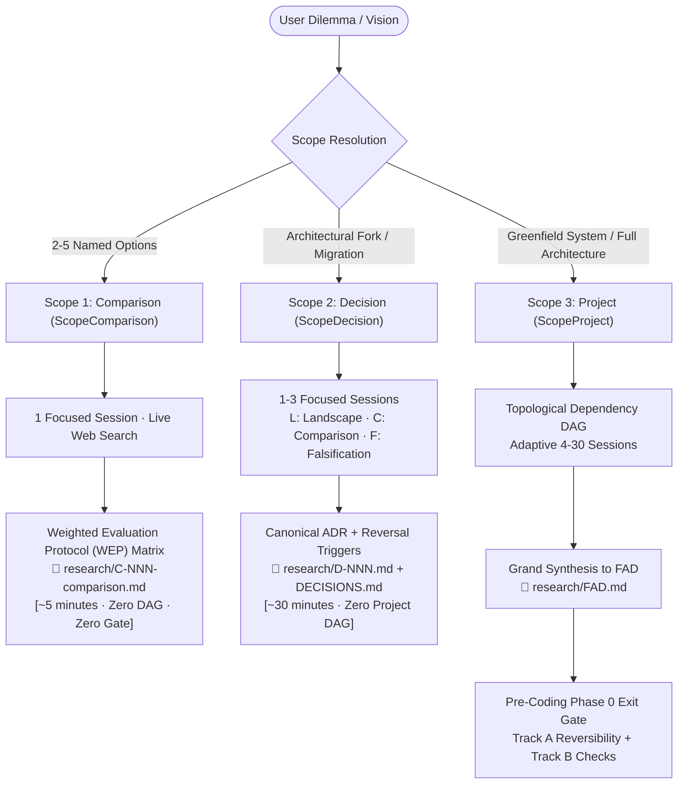

<div align="center">

<picture>
  <source media="(prefers-color-scheme: dark)" srcset="docs/assets/logo-dark.svg">
  
</picture>

# Vivechak (विवेचक)
### Evidence-Grounded Research for Architectural & Technical Decisions

[](https://github.com/bhaskarjha-dev/vivechak/releases)
[](https://golang.org)
[](https://modelcontextprotocol.io)
[](https://github.com/bhaskarjha-dev/vivechak/actions)
[-success.svg?style=flat-square)](#telemetry)
[](LICENSE)

*vi- (apart) + √vic (to sift/separate) + -aka (the agent who does) = "the discerning analyst"*

**Transform high-stakes decisions from gut-feel and cached model memory into structured, evidence-graded research — whether you're evaluating competing datastores, resolving an architectural fork, or mapping a full system from scratch.**

[**Quick Start**](#quick-start) • [**Show, Don't Tell**](#show-dont-tell) • [**The 3 Scopes**](#three-scopes) • [**Why Vivechak?**](#why-vivechak) • [**Installation**](#installation) • [**13 MCP Tools**](#mcp-tools) • [**Evidence Hierarchy**](#evidence-hierarchy) • [**Docs Hub**](#documentation-hub)

</div>

---

> **What you're installing:** A single standalone Go binary (`vck`) with **zero runtime dependencies**, **zero cloud phone-home**, and **zero telemetry**. It runs 100% locally on your machine as both a developer CLI (`vck doctor`, `vck setup`, `vck gate`) and an orchestration MCP server (`vck serve`) for AI coding agents.

---

<a id="quick-start"></a>
## ⚡ Quick Start (In 60 Seconds)

Vivechak equips your AI coding agent (Cursor, VS Code, Claude Code, Antigravity, OpenCode) with **13 Model Context Protocol (MCP) tools** for structured research.

### Step 1: Connect Your Host in 1 Command

Run ephemerally with zero pre-installation:
```sh
# Node.js / npx
npx -y vck serve                              # or: npx -y vivechak serve

# Python / uvx
uvx vck serve                                 # or: uvx vivechak serve
```

Or install the native binary and auto-configure your editor in 1 second:
```sh
# macOS & Linux (Homebrew)
brew install bhaskarjha-dev/tap/vck

# Windows (WinGet)
winget install bhaskarjha-dev.Vivechak

# Auto-configure your active AI editor:
vck setup cursor                             # Cursor IDE
vck setup vscode                             # VS Code (Copilot Agent mode)
vck setup claude-code                        # Claude Code CLI (~/.claude.json or .mcp.json)
vck setup agy                                # Google Antigravity
vck setup                                    # Auto-detects editor in current workspace

# Or install universal agent skill directly:
npx skills add bhaskarjha-dev/vivechak
```

### Step 2: Prompt Your Agent Naturally (or use Slash Commands)

Open your agent's chat window in any active project. You can prompt naturally or use native **MCP Slash Commands** (`/vivechak_...`):

| What You Need | What You Prompt / Slash Command | What Vivechak Does |
|---|---|---|
| **Compare 2–5 Options**<br>*(~5 min · 0 DAG · 0 Gate)* | `/vivechak_compare`<br>*or "Vivechak compare: Pino vs Winston"* | Runs 1 session with web search → Generates Weighted Evaluation Protocol (WEP) matrix with Grade A/B citations in `research/C-01-comparison.md`. |
| **Lock an Architectural ADR**<br>*(~30 min · 1–3 sessions)* | `/vivechak_decision`<br>*or "Vivechak decision: PostgreSQL vs ClickHouse"* | Evaluates blast radius & reversibility → Runs Landscape & Falsification sessions → Locks canonical ADR `research/D-01.md` with reversal triggers. |
| **Architect a Greenfield System**<br>*(Hours–Days · Full DAG)* | `/vivechak_project`<br>*or "Use Vivechak to architect real-time pipeline"* | Builds dependency DAG → Loops sessions → Synthesizes Founding Architecture Document (`FAD.md`) → Validates pre-code Phase 0 Exit Gate. |
| **Pre-Code Exit Gate**<br>*(Pre-Implementation)* | `/vivechak_gate`<br>*or "Evaluate Phase 0 Gate"* | Evaluates Track A reversibility and Track B rigor checks mechanically before starting implementation. |

> 🚫 **Anti-Pattern Guardrail (When NOT to use Vivechak):** Skip Vivechak for direct code authoring, syntax questions, local bug fixing, or trivial refactoring (e.g. *"Write a Go function to parse JWT"*). Your agent writes code directly without calling research tools.

---

<a id="show-dont-tell"></a>
## 🎯 Show, Don't Just Tell: The Output Quality

Vivechak stops AI agents from rubber-stamping architectural choices using hallucinations or stale training data.

### Without Vivechak vs. With Vivechak

```
WITHOUT VIVECHAK (Raw LLM Prompting)
┌────────────────────────────────────────────────────────────────────────┐
│ "ClickHouse is very fast and scalable for event logging. It can handle  │
│ millions of events easily. You should use ClickHouse over PostgreSQL."   │
│                                                                        │
│ ❌ Unverified assertions based on cached training memory                │
│ ❌ Zero quantification of operational complexity or team familiarity    │
│ ❌ Zero reversal triggers or migration failure modes                    │
│ ❌ Severe confirmation bias towards whatever the user suggested        │
└────────────────────────────────────────────────────────────────────────┘

WITH VIVECHAK (Evidence-Graded Research & Bounded ADR)
┌────────────────────────────────────────────────────────────────────────┐
│ DECISION: Retain PostgreSQL with TimescaleDB; Defer ClickHouse          │
│ STATUS: Locked (Two-Way Door with Review Trigger at 50M events/day)    │
│                                                                        │
│ EVIDENCE:                                                              │
│ • Write Throughput: TimescaleDB handles 35k events/sec on current r6g   │
│   nodes [Grade A: Timescale Benchmark 2025; Canonical docs].           │
│ • Operational Friction: ClickHouse mutation/DELETE penalty requires    │
│   ReplacingMergeTree, introducing compaction latency spikes           │
│   [Grade A: ClickHouse Core Docs; Grade B: Cloudflare Incident #142].  │
│ • Operational Reality: Team has zero ClickHouse DBA experience;        │
│   Postgres connection pooling (PgBouncer) already tuned in production. │
│                                                                        │
│ REVERSAL TRIGGER:                                                      │
│ • If uncompressed event ingest exceeds 50M events/day OR 30-day query   │
│   p95 exceeds 2500ms, trigger Decision D-02 for ClickHouse sharding.   │
└────────────────────────────────────────────────────────────────────────┘
```

---

<a id="three-scopes"></a>
## 🔬 The 3 Scopes Continuum

Vivechak adapts its methodology to the reversibility and blast radius of the decision. You never pay full project DAG overhead for a simple library evaluation:



---

<a id="why-vivechak"></a>
## 💡 Why Not Just Ask an AI?

Deep research search tools (Gemini Deep Research, ChatGPT Deep Research, Perplexity) are search engines that retrieve individual pages. **Vivechak is the epistemic orchestration layer above them.**

| Dimension | Raw LLM Chat | Deep Search Engines | Vivechak + AI Coding Agent |
|---|---|---|---|
| **Evidence Grading** | Stale training weights (unverified) | Web citations without epistemic tiers | **Strict GRADE A–E hierarchy** with qualified provenance |
| **Bias Mitigation** | High confirmation bias (agrees with prompt) | Search bias towards SEO-optimized content | **Structured Falsification** (P8) seeking disconfirming evidence |
| **One-Way vs Two-Way Doors** | Treats all questions identically | Treats all queries identically | **Reversibility-Calibrated Rigor** (P2) |
| **Reversal Triggers** | None | None | **Mandatory quantitative triggers & decay conditions** |
| **Synthesis & Architecture** | Single unstructured markdown chat response | Long search report | **Coherent Founding Architecture (FAD)** ready for coding |
| **Pre-Code Gate** | None (start coding on vibes) | None | **Automated Phase 0 Gate** (11 automated pre-code verifications) |

---

<a id="installation"></a>
## 📦 Installation

Vivechak installs both the canonical binary **`vivechak`** and its official shorthand **`vck`** across every platform:

### 1. Instant / Ephemeral Runners (Zero Pre-Installation Required)
```sh
# Node.js / npx (macOS, Linux, Windows)
npx -y vck serve                              # or: npx -y vivechak serve

# Python / uvx (macOS, Linux, Windows)
uvx vck serve                                 # or: uvx vivechak serve

# Docker / Cloud Agents (Devin, OpenHands, CI)
docker run -i --rm -v "${PWD}:/workspace" ghcr.io/bhaskarjha-dev/vck:latest serve
```

### 2. Native Package Managers
```sh
# Homebrew (macOS & Linuxbrew)
brew install bhaskarjha-dev/tap/vck           # or: brew install bhaskarjha-dev/tap/vivechak

# Windows (WinGet or Scoop)
winget install bhaskarjha-dev.Vivechak
scoop bucket add vivechak https://github.com/bhaskarjha-dev/scoop-bucket && scoop install vck

# Debian / Ubuntu (.deb) & Fedora / RHEL (.rpm)
sudo dpkg -i vivechak_0.1.0_linux_amd64.deb   # Debian / Ubuntu
sudo rpm -i vivechak_0.1.0_linux_amd64.rpm    # Fedora / RHEL

# Nix / NixOS
nix run github:bhaskarjha-dev/vivechak

# Direct Shell Installers
curl -fsSL https://raw.githubusercontent.com/bhaskarjha-dev/vivechak/main/install.sh | sh      # macOS/Linux
irm https://raw.githubusercontent.com/bhaskarjha-dev/vivechak/main/install.ps1 | iex           # Windows
```

<details>
<summary><b>Build from Source (Go 1.25+)</b></summary>

```sh
# 1. Clone repository
git clone https://github.com/bhaskarjha-dev/vivechak.git
cd vivechak

# 2. Build both vck and vivechak binaries:
make build

# Or manually with production optimization flags:
# (-trimpath strips paths; -s -w strips debug symbols & DWARF info for ~35% smaller binary)
CGO_ENABLED=0 go build -trimpath -ldflags="-s -w -X main.version=0.1.0" -o vck ./cmd/vivechak/
CGO_ENABLED=0 go build -trimpath -ldflags="-s -w -X main.version=0.1.0" -o vivechak ./cmd/vivechak/

# 3. Verify binary:
./vck version                                 # displays: vivechak 0.1.0
```
Or install directly into your `$GOPATH/bin`:
```sh
go install github.com/bhaskarjha-dev/vivechak/cmd/vivechak@latest
```
</details>

---

## ⚙️ Universal AI Host Configuration

Vivechak configures host configurations automatically via `vck setup <host>`. If you prefer manual configuration, add Vivechak to your AI editor:

### Universal `.mcp.json` / Claude Desktop / Cursor
```json
{
  "mcpServers": {
    "vivechak": {
      "command": "vck",
      "args": ["serve"]
    }
  }
}
```
*(If using `npx`, replace `"command": "vck"` with `"command": "npx"` and `"args": ["-y", "vck", "serve"]`)*.

---

<a id="mcp-tools"></a>
## 🛠️ The 13 MCP Orchestration Tools

When registered as an MCP server, Vivechak equips your agent with 13 specialized orchestration tools:

| Category | Tool | Description |
|---|---|---|
| **Initialization** | `vivechak_init` | Scaffolds workspace structure and injects scope-appropriate templates (1 for comparison, 2 for decision, 6 for project). |
| | `vivechak_prepare_generator` | Generates calibrated research prompts with upstream context, scope guardrails, and anti-spill directives. |
| **Pipeline & Execution** | `vivechak_save_plan` | Validates & persists the research DAG (supports `pipeline_content` alias; auto-initializes workspace). |
| | `vivechak_status` | Returns topological progress, completed nodes, and blocked dependency queues. |
| | `vivechak_next_session` | Injects upstream research findings into the next unblocked session with active calibration rules. |
| | `vivechak_save_session` | Validates session markdown, provides real-time cognitive coaching (`Q-*`), and mirrors FAD updates. |
| **Decisions & Governance** | `vivechak_record_decision` | Locks canonical ADRs (`D-NNN.md`), compiles `DECISIONS.md`, and supports single-turn drafting (`auto_save: true`). |
| | `vivechak_amend_session` | Appends post-hoc amendments and fires transitive downstream stale warnings (`W-STALE-DOWNSTREAM`). |
| | `vivechak_validate` | Runs validation ladder on any research artifact or validates entire workspace health. |
| | `vivechak_challenge` | Executes adversarial red-teaming, evidence integrity audits, and cross-session consistency checks. |
| **Synthesis & Exit Gate** | `vivechak_replan` | Dynamically mutates mid-flight DAG topology (adds sessions, rewires dependencies). |
| | `vivechak_visualize` | Renders DAG as a Mermaid flowchart or ASCII progress table. |
| | `vivechak_run_gate` | Headless Phase 0 Exit Gate evaluator (decoupled Track A reversibility and Track B B1–B11 checks). |

### ⚡ Native MCP Prompts & Resources

Vivechak implements all three primitives of the Model Context Protocol specification:

#### 1. Native Prompts (Slash Commands)
Type `/` in your MCP-compatible chat window (Claude Desktop, Cursor, Continue, Zed) to launch calibrated research workflows:
- `/vivechak_compare`: Interactive UI form to evaluate 2–5 options with a WEP matrix (~5 min).
- `/vivechak_decision`: Interactive UI form to resolve an architectural dilemma into an ADR (~30 min).
- `/vivechak_project`: Interactive UI form to decompose a greenfield system into an adaptive DAG to a FAD.
- `/vivechak_gate`: Evaluate pre-codebase exit criteria via the Phase 0 Gate.

#### 2. Canonical Resources (`vivechak://...`)
Reference canonical templates and methodology cards directly in chat or prompt context:
- `vivechak://templates/decisions`: Architecture Decision Record (ADR) template.
- `vivechak://templates/comparison`: Weighted Evaluation Protocol (WEP) matrix template.
- `vivechak://templates/fad`: Founding Architecture Document (FAD) template.
- `vivechak://templates/conflict-resolution`: Analysis of Competing Hypotheses (ACH) template.
- `vivechak://templates/gate`: Phase 0 Pre-Codebase Exit Gate checklist.
- `vivechak://templates/session`: Research session format with Prior, Delta, and Evidence Ledger.
- `vivechak://methodology/grades`: Grade A–E evidence taxonomy reference card.
- `vivechak://methodology/principles`: The 8 core principles reference card.

#### 3. Universal Agent Skill & Pre-Packaged Rules
Equip your AI agent with calibrated operating rules:
- **Universal Skill (`agentskills.io`):** `npx skills add bhaskarjha-dev/vivechak`
- **Cursor Rules:** [`templates/rules/cursor.mdc`](templates/rules/cursor.mdc) (copy to `.cursor/rules/vivechak.mdc`)
- **Claude Code Rules:** [`templates/rules/claude.md`](templates/rules/claude.md) (copy to `.claude/rules/vivechak.md`)
- **Google Antigravity:** [`templates/rules/antigravity.md`](templates/rules/antigravity.md) (copy to `.agents/rules/vivechak.md`)

---

<a id="evidence-hierarchy"></a>
## 📊 Evidence Grading Hierarchy

Vivechak enforces the **GRADE-aligned evidence taxonomy** (Principle P3). Every claim in a research artifact must carry an inline evidence grade with qualified provenance:

```
┌─────────┬─────────────────────────────┬─────────────────────────────────────────────────────────┐
│ Grade   │ Epistemic Reliability       │ Required Provenance & Source Standard                   │
├─────────┼─────────────────────────────┼─────────────────────────────────────────────────────────┤
│ Grade A │ High Certainty              │ Direct canonical docs, official RFCs, source inspect.   │
│ Grade B │ Moderate Certainty          │ Reproducible benchmark, production post-mortem, CVE.    │
│ Grade C │ Low Certainty               │ Community consensus, tech blog, secondary source.       │
│ Grade D │ Model Recall (Ceiling)      │ Unverified LLM training memory (strictly capped at D).  │
│ Grade E │ Speculative / Unverified    │ Claims without empirical backing, uncorroborated roadmaps. │
└─────────┴─────────────────────────────┴─────────────────────────────────────────────────────────┘
```
> **Qualified Provenance Rule:** Grade A claims require canonical URLs, RFC numbers, or source citations. Computing memory (RAM/caches) is never penalized as model recall.

---

<a id="cli-reference"></a>
## 💻 Developer CLI Reference

The `vck` executable doubles as a powerful diagnostic and governance CLI:

```sh
# Auto-configure 21 AI host presets (cursor, vscode, claude, agy, opencode, etc.):
vck setup [host]

# Verify workspace health, template integrity, and research directories:
vck doctor

# Headless Phase 0 exit gate evaluation (CI-ready):
vck gate --track all

# Output universal MCP JSON configuration snippet for copy-pasting:
vck mcp-config

# Print version and build metadata:
vck version
```

---

<a id="telemetry"></a>
## 🛡️ Zero-Telemetry & Privacy Guarantee

Vivechak is built with a strict zero-trust privacy posture:
- **Zero Cloud Calls:** The server initiates zero telemetry, tracking, or network requests.
- **100% Local Confinement:** Confined to the project root directory via Go 1.24+ `os.Root` sandboxing to prevent path traversal.
- **Atomic Concurrency:** Employs advisory file locking (`flock`) and monotonic counters to ensure safety across parallel AI subagents.

---

## 🧪 Autonomous Multi-Harness Verification & Stress Testing

Vivechak includes an empirical multi-harness autonomous testing engine in [`tests/harness/`](tests/harness/) that subjects the framework to zero-trust stress-testing across diverse AI host CLIs (Google Antigravity, OpenCode, Claude Code) and headless MCP environments:

* **21 Realistic Scenarios:** Evaluates messy, adversarial developer prompts across all three scopes and enforces the out-of-scope code authoring boundary.
* **Deterministic Offline Verification (0 Tokens, ~1.5s):** Tests all 13 MCP tools over JSON-RPC stdio with zero network or AI credit expenditure:
  ```bash
  node scripts/run_harness.mjs --harness direct_mcp --batch all
  ```
* **Parallel Pre-Flight Health & Quota Probing:**
  ```bash
  make harness-probe                          # or: node scripts/run_harness.mjs --probe
  ```
* **Living Defect Ledger:** All empirical findings and engine hardenings are permanently tracked in [`tests/harness/DEFECTS.md`](tests/harness/DEFECTS.md) and frozen in milestone audit reports in [`tests/harness/reports/`](tests/harness/reports/).

---

<a id="documentation-hub"></a>
## 📚 Documentation Hub

| Category | Guide | Description |
|---|---|---|
| **Getting Started** | [**Quickstart Guide**](docs/QUICKSTART.md) | Vivechak in 5 Minutes across comparison, decision, and project scopes |
| | [**Host Setup Guide**](docs/HOST-SETUP.md) | Universal MCP setup across 21 AI harnesses (Cursor, Claude, Antigravity, etc.) |
| | [**Manual Workflow**](docs/MANUAL-WORKFLOW.md) | Zero-install guide for running Vivechak in web chat without the MCP server |
| | [**Troubleshooting**](docs/TROUBLESHOOTING.md) | Diagnostic runbooks and comprehensive error code catalog (`E-*`, `W-*`, `Q-*`) |
| **Architecture & MCP** | [**Architecture Internals**](docs/ARCHITECTURE.md) | Server internals, package dependency diagrams, and concurrency model |
| | [**MCP Tools Reference**](docs/MCP-TOOLS.md) | Complete 13-tool API reference with example JSON-RPC payloads and schemas |
| | [**Harness Compatibility**](docs/HARNESS-COMPATIBILITY.md) | Compatibility matrix across 8 AI agent harness categories |
| **Advanced Workflows** | [**Parallel Execution**](docs/PARALLEL-EXECUTION.md) | Concurrent subagents and advisory file locking (`flock`) architecture |
| | [**Hybrid Execution**](docs/HYBRID-EXECUTION.md) | Native hybrid operations combining MCP automation with manual human browser research |
| | [**Brand Identity**](docs/BRAND.md) | Brand identity, optical sizing, geometry blueprints, and design tokens |
| **Scientific Provenance** | [**Meta-Research Base**](docs/meta-research/) | Empirical evidence base with all 14 locked ADRs (D-001–D-014) and UX decisions |

---

## 📜 Origin & Philosophy

### Why This Exists

Software venture failures almost never stem from bad code — they stem from **premature architectural commitments made on unverified assumptions.** The cost of wrong decisions compounds exponentially: a bad database choice costs 10× more to fix at month 6 than at month 0.

Vivechak was born from 8 real project research pipelines (2024–2026), each independently discovering pieces of the same methodology: unbiased landscape cataloging, evidence grading, aspect isolation, decision registries, and synthesis protocols.

### The Empirical Self-Validation

In August 2026, the framework was subjected to its own methodology. 11 independent deep research sessions (producing 15 artifacts across multiple AI platforms) tested every foundational assumption. Of 10 hypotheses, **0 survived unchanged**:

| Legacy Dogma | Verdict | Resolution |
|---|---|---|
| Absolute aspect-isolation | Refined | Context Architecture Law — conditional decomposition + synthesis |
| Mandatory 3-model triangulation | Refined | Staged, risk-triggered protocol |
| Fixed 17–27 sessions | Refuted | 4-tier adaptive scaling (1–30) |
| 8-section XML prompts | Refuted | 8-block prompt anatomy |
| Expert personas improve research | Refuted | Personas debunked for factual accuracy |
| Fixed ~40/60 compose/build | Refined | Wardley evolution mapping |

The most load-bearing finding: **how you frame a research question measurably biases what "evidence" a model reports back.** This single finding justifies the entire framework — unstructured "just ask the AI" research is systematically vulnerable to confirmation bias.

### FRAMEWORK.md — The Deep Reference

[FRAMEWORK.md](FRAMEWORK.md) contains the complete methodology specification — 8 principles, evidence grading system, pipeline topology, prompt anatomy, and synthesis workflows. **You do not need to read it to use Vivechak.** The generator prompts are self-contained; all methodology is operationalized inline. FRAMEWORK.md is the definitive reference for understanding *why* the methodology works.

---

## 🗺️ Roadmap

| Phase | Status | Description |
|---|---|---|
| 1: Foundation (Gen 1) | ✅ | 8 project methodologies consolidated into initial patterns |
| 2: Self-Validation (Gen 2) | ✅ | 11 meta-research sessions → 10 verdicts → Gen 3 spec |
| 3: Framework Release (v0.1.0) | ✅ | Framework, generators, templates, bias correction |
| 4: Methodology Expansion | ✅ | 3 scope levels (Project / Decision / Comparison) |
| 5: MCP Server | ✅ | Go MCP server with 13 tools, full test suite passing |
| 6: Distribution | ✅ | GoReleaser, installers, Homebrew/Scoop/winget, CI pipelines |
| 7: Demand Proof | Next | Real case study, free wedge skill, content marketing |
| 8: Research Frontiers | Future | DSPy optimization, multi-agent debate, longitudinal calibration |

See [ROADMAP.md](ROADMAP.md) for detailed plans and evidence corpus.

---

## ⚖️ License & Community

- **License:** Distributed under the [MIT License](LICENSE).
- **Contributing:** Read [CONTRIBUTING.md](CONTRIBUTING.md) and [AGENTS.md](AGENTS.md) before submitting pull requests. All changes must be traceable to empirical evidence.
- **Security:** Review [SECURITY.md](SECURITY.md) for vulnerability disclosure policies.
