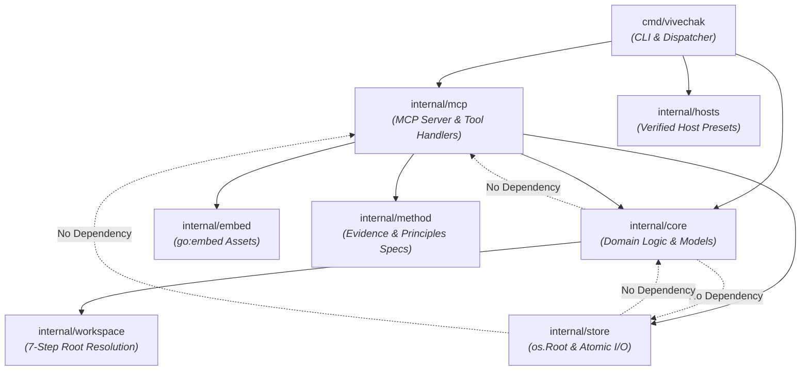
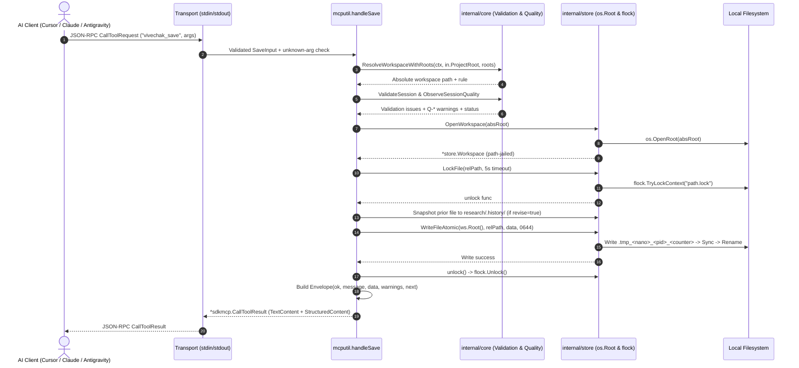

# Server Architecture Guide

> **Last verified against code:** 2026-11-24 (v0.1.0)
> If you find discrepancies with the actual code, please file an issue.

Welcome to the internal architecture guide for **Vivechak** (विवेचक). This document is written for Go developers and contributors who want to understand, extend, or maintain the Vivechak MCP server codebase.

Vivechak is an evidence-grounded research meta-framework for technical decisions. It operates across three distinct research scopes:
1. **Project** ([`GENERATOR-PROJECT.md`](../GENERATOR-PROJECT.md)) — Full research pipeline producing a Founding Architecture Document (FAD) across 4–30 DAG-ordered sessions.
2. **Decision** ([`GENERATOR-DECISION.md`](../GENERATOR-DECISION.md)) — Single architectural decision producing an Architectural Decision Record (ADR) across 1–3 sessions.
3. **Comparison** ([`GENERATOR-COMPARISON.md`](../GENERATOR-COMPARISON.md)) — Bounded technology evaluation producing a Weighted Evaluation Protocol (WEP) matrix across 2–5 options in a single session.

The project ships as both a zero-dependency manual workflow and an autonomous **Model Context Protocol (MCP)** server providing 9 consolidated tools, 4 native prompts, and 8 read-only resources.

---

## 1. Package Layout & Dependency Architecture

The codebase follows a strict separation of concerns. Pure domain logic has zero dependency on the MCP protocol or transport layer, allowing fast, isolated testing and clean architectural boundaries.

```
vivechak/
├── cmd/
│   └── vivechak/               # CLI entry points and host configurations
│       ├── main.go             # Command dispatcher, stdio server startup, slog routing (vck alias)
│       ├── config.go           # "mcp-config" JSON generation, launcher resolution, config merging & atomic write
│       ├── presets.go          # Supported AI editor/harness host presets wrapper (10 presets)
│       ├── setup.go            # "setup" / "install" CLI, workspace auto-detection, diffs & secret redaction
│       ├── doctor.go           # "doctor" workspace integrity verification and detected scope diagnostics
│       ├── gate.go             # "gate" headless Phase 0 exit gate evaluation (CI-ready)
│       └── signoff.go          # "signoff" interactive human architectural review sign-off
├── internal/
│   ├── core/                   # Pure business logic (DAG, gate, validation, quality, scopes, signoff)
│   │   ├── scope.go            # Scope definitions (project, decision, comparison) & auto-inference
│   │   ├── workspace.go        # Workspace layout, WorkspaceFS, session/decision scanning
│   │   ├── dag.go              # Fenced yaml vivechak-plan DAG parsing and topological resolution
│   │   ├── codes.go            # Canonical E-*/V-*/W-*/Q-* diagnostic code registry
│   │   ├── gate.go             # Phase 0 Exit Gate evaluation engine (Rules G1–G12)
│   │   ├── gate_rules_spec.go  # Canonical G1–G12 rule definitions (shared with tools/docgen)
│   │   ├── gate_render.go      # Gate markdown artifact rendering
│   │   ├── signoff.go          # Human sign-off verification & E-HUMAN-ONLY-FIELD guard
│   │   ├── draft_decision.go   # Automated ADR drafting from session recommendations
│   │   ├── frontmatter.go      # YAML frontmatter parsing and composition
│   │   ├── inject.go           # Upstream context injection (<upstream-findings> wrappers)
│   │   ├── markdown.go         # CommonMark fence tracking (FenceTracker) & section extraction
│   │   ├── validate.go         # Structural validation ladder (L1–L4)
│   │   ├── validate_evidence.go # Evidence grade & qualified provenance rules
│   │   ├── quality.go          # Advisory quality coaching (Q-*) & dynamic freshness
│   │   ├── challenge.go        # Adversarial red-team challenge prompt & outcome hashing
│   │   └── visualize_comparison.go # Comparison Scope WEP visualization engine
│   ├── workspace/              # 7-step fail-closed workspace resolution ladder & OS boundary guards
│   ├── mcp/                    # MCP protocol server, tools, prompts, and resources (package mcputil)
│   │   ├── server.go           # Server factory, per-session workspace memory & panic recovery
│   │   ├── schema.go           # ToolSpec/ParamSpec JSON Schema builder & unknown-arg warning decoding
│   │   ├── envelope.go         # Canonical JSON response envelope (ok, code, message, fix, data, warnings, next)
│   │   ├── roots.go            # MCP client roots/list resolution & cache invalidation
│   │   ├── session_state.go    # Per-session state (workspace memory, roots cache, allocated IDs)
│   │   ├── artifact_ids.go     # Canonical ID allocation & placeholder-reference resolution
│   │   ├── challenge_store.go  # D-NNN-R1.md challenge record persistence
│   │   ├── tool_*.go           # 9 consolidated MCP tool handlers
│   │   ├── prompts.go          # 4 native MCP prompt templates (compare, decision, project, gate)
│   │   ├── resources.go        # 8 canonical read-only MCP resources (templates & methodology)
│   │   └── server_test.go      # In-memory JSON-RPC wire tests
│   ├── store/                  # Storage, path jail, and concurrency primitives
│   │   ├── workspace.go        # os.Root confinement wrapper & revision snapshots (.history/)
│   │   ├── atomic.go           # Crash-safe atomic file writes with monotonic counters
│   │   └── lock.go             # Cross-process advisory file locking (flock)
│   ├── hosts/                  # Verified MCP host preset registry (shared with cmd/vivechak & docgen)
│   ├── method/                 # Canonical evidence.json & principles.json methodology definitions
│   ├── version/                # Build-time version, commit, and timestamp metadata
│   └── embed/                  # Compile-time embedded assets (package vembed)
│       ├── embed.go            # go:embed accessors for generators, templates, skills, and rules
│       ├── generators/         # Embedded generator markdown prompts
│       ├── templates/          # Embedded workspace markdown templates
│       ├── skills/             # Embedded universal agent skill manifest
│       └── rules/              # Embedded editor and harness rule templates
└── tools/
    └── docgen/                 # Deterministic code-to-docs generator (tools.md, codes.md, gate.md, hosts.md, FRAMEWORK.md)
```

### Dependency Direction

The dependency flow is strictly unidirectional:



Key architectural rules:
1. **[`internal/core`](../internal/core/scope.go) has NO dependency on MCP or Store**: Domain logic relies only on the Go standard library, [`internal/workspace`](../internal/workspace), and [`gopkg.in/yaml.v3`](../go.mod). You can test DAG parsing, upstream injection, frontmatter handling, gate evaluation, and validation without launching an MCP server or writing to disk.
2. **[`internal/store`](../internal/store/workspace.go) is independent**: It handles low-level filesystem confinement via `os.Root`, advisory locks via `github.com/gofrs/flock`, revision backups in `research/.history/`, and atomic write semantics. It knows nothing about MCP requests or Vivechak research concepts.
3. **[`internal/mcp`](../internal/mcp/server.go) bridges protocol to domain**: Handlers decode MCP inputs through [`registerTool`](../internal/mcp/schema.go), call `internal/core` algorithms, persist via `internal/store`, and package results into the canonical [`Envelope`](../internal/mcp/envelope.go).
4. **Stdio Protocol Discipline**: As defined in [`cmd/vivechak/main.go`](../cmd/vivechak/main.go), the server communicates with AI hosts over `stdin`/`stdout`. **`stdout` is strictly reserved for JSON-RPC MCP messages**. Any stray `fmt.Println` or unrouted log on `stdout` corrupts the transport and breaks the host client. All logging is routed through `log/slog` writing exclusively to `os.Stderr`.

---

## 2. Key Abstractions

### Scope (`core.Scope`)
Defined in [`internal/core/scope.go`](../internal/core/scope.go), `Scope` encapsulates the three research tiers:
- `ScopeProject` (`"project"`): Multi-session architectural investigation (4–30 sessions), producing `RESEARCH-PIPELINE.md`, `DECISIONS.md`, and ultimately a Founding Architecture Document (`FAD.md`).
- `ScopeDecision` (`"decision"`): Targeted investigation for a single decision (1–3 sessions), producing an Architectural Decision Record (`D-NNN-*.md` and compiled `DECISIONS.md`).
- `ScopeComparison` (`"comparison"`): Rapid, bounded comparison of 2–5 options producing a Weighted Evaluation Protocol matrix (`C-NNN-comparison.md`) in a single session.

### Workspace & 7-Step Fail-Closed Resolution Ladder
Implemented in [`internal/workspace`](../internal/workspace) and exposed via [`internal/core/workspace.go`](../internal/core/workspace.go), `ResolveWorkspaceWithRoots` evaluates a deterministic 7-step fail-closed ladder:
1. **Explicit `project_root` argument**: Passed directly in the MCP tool call or CLI command.
2. **Single MCP client root (`roots/list`)**: Queried only when advertised by the client at `initialize` (cached per session and refreshed on `notifications/roots/list_changed`; skipped if zero or multiple roots are returned).
3. **Namespaced environment variables**: Evaluated in order (`VIVECHAK_PROJECT_ROOT`, then `VCK_PROJECT_ROOT`), ignoring unexpanded editor macros (`${workspaceFolder}`) and unnamespaced variables (`WORKSPACE`, `PROJECT_ROOT`) to protect container isolation.
4. **Per-session memory**: Falls back to the workspace already resolved earlier in the same MCP session (never shared across concurrent or sequential sessions).
5. **Marker walk-up from `cwd`**: Walks upward from `cwd` looking specifically for an existing `research/.vivechak.json` workspace marker.
6. **Guarded `cwd`**: Accepts `cwd` itself only if it carries a project root manifest (`.git`, `go.mod`, `package.json`, `Cargo.toml`, `pyproject.toml`) and is not `/`, `$HOME`, a temp directory, or an OS/application program directory.
7. **Fail-closed refusal (`E-ROOT-UNRESOLVED`)**: Refuses to guess or write to disk, returning an actionable `fix` instructing the caller to pass `project_root`.

The workspace layout is standard across Vivechak projects:
- `research/` — Workspace root (containing `.vivechak.json` and `.gitignore` ignoring `*.lock` and `.history/`)
- `research/sessions/` — Markdown outputs from individual research sessions
- `research/.history/` — Automatic timestamped snapshots written when `revise=true` overwrites an existing artifact
- `research/RESEARCH-PIPELINE.md` — Project DAG plan containing the fenced `yaml vivechak-plan` block and session prompts (or `research/D-NNN-plan.md` in Decision scope)
- `research/D-NNN-*.md` & `research/DECISIONS.md` — Canonical standalone ADRs and the auto-compiled central decision registry
- `research/D-NNN-R1.md` — Adversarial red-team challenge records tied to an ADR's Decision Outcome SHA-256 hash
- `research/FAD.md` & `FOUNDING-ARCHITECTURE.md` — Synthesized Founding Architecture Document and its root-level mirror
- `research/PHASE-0-GATE.md` — Auto-persisted Phase 0 exit gate evaluation report
- Templates are served on demand as read-only MCP resources (`vivechak://templates/...`) rather than copied into `research/`.

### Pipeline DAG (`core.DAG` & `yaml vivechak-plan`)
Defined in [`internal/core/dag.go`](../internal/core/dag.go), `ParsePipeline` parses plans strictly from the fenced `yaml vivechak-plan` block (emitting `V-PLAN-BLOCK-MISSING` or `V-PLAN-SCHEMA` if absent or malformed, rather than guessing from prose or Markdown tables):
- **`Session` Node**: Captures `ID` (e.g., `T1-01`, `SYN-01`), `Title`, `Layer`, `Kind` (`research` or `synthesis`), `DoorType`, `Dependencies`, `InformsDecisions`, `OutputFile`, and the extracted session `Prompt` under `## Sessions`.
- **Single Synthesis Sink (`kind: synthesis`)**: Project plans declare exactly one terminal synthesis node (`kind: synthesis`), which `DAG.NextSessions` holds back until 100% of non-synthesis research sessions have completed (`status: complete`).
- **Topological Progression (`DAG.NextSessions`)**: Computes unblocked ready sessions from completed session IDs (excluding `status: draft` artifacts) and surfaces parallel tracks via `other_ready_sessions` and `parallelism_hint`.

### Frontmatter Parser (`core.Frontmatter`)
Defined in [`internal/core/frontmatter.go`](../internal/core/frontmatter.go), `ParseFrontmatter` and `ComposeFrontmatter` parse and update YAML frontmatter (supporting standard `---` blocks, leading `# Heading` preambles, and `<details>` blocks in multi-decision registries) without mangling markdown body fences, tables, or Unicode content.

### Validation Ladder (`core.ValidationLevel`)
Defined in [`internal/core/validate.go`](../internal/core/validate.go), Vivechak uses a 4-level validation ladder:

| Level | Identifier | Behavior | Trigger Conditions |
|---|---|---|---|
| **L1** | `L1Construct` | Auto-remedies missing values | Missing non-critical fields (e.g., defaulting missing `status` or normalizing frontmatter IDs). |
| **L2** | `L2Block` | Persists as `draft` (or blocks plan save) | Missing YAML frontmatter, missing mandatory fields (`session_id`, `title`, `date`), malformed `vivechak-plan` block, empty body. |
| **L3** | `L3Warn` | Emits non-fatal `warnings` | Missing inline evidence grades (suppressed for `status: proposed` seed ADRs), missing `door_type`, thin rationale. |
| **L4** | `L4Gate` | Phase 0 Exit Gate (`G1`–`G12`) | Mechanical pre-coding verification across Track A (Two-Way Doors) and Track B (One-Way Doors). |

### Quality Coaching Engine (`core.ObserveSessionQuality`)
Defined in [`internal/core/quality.go`](../internal/core/quality.go), `ObserveSessionQuality` runs during `vivechak_save` and dry-run `vivechak_review(mode="validate")`, surfacing non-blocking `Q-*` coaching warnings:
- **Grade A Qualified Provenance (`Q-PROVENANCE`):** Checks that Grade A claims cite canonical URLs, RFCs, or ledger anchors, while ensuring computing memory terms (`RAM`, `in-memory cache`) are never misclassified as model recall.
- **Citation Diversity (`Q-DENSITY`) & Findings Depth (`Q-DEPTH`):** Advises when substantive sessions cite fewer than 2 distinct external sources or document fewer than 3 key findings.
- **Discovered Concerns & Rigor (`Q-RIGOR`):** Checks for substantive unexpected concerns (≥50 characters) and rejected alternatives.
- **Confirmation Bias (`Q-BIAS`) & Freshness (`Q-STALE`):** Flags 100%-confirmed prior-belief tables and potentially stale year citations.

### Phase 0 Gate Engine (`core.EvaluateGate` & `mcputil.handleGate`)
Defined in [`internal/core/gate.go`](../internal/core/gate.go) and [`internal/core/gate_rules_spec.go`](../internal/core/gate_rules_spec.go), `vivechak_gate` (and CLI `vck gate`) evaluates 12 rules (`G1`–`G12`) and writes `research/PHASE-0-GATE.md`:
- **Project Structural Closure (`G1`–`G5`):** Valid `vivechak-plan` DAG with one synthesis sink (`G1`), all planned sessions completed (`G2`), `FAD.md` covering accepted ADRs (`G3`), all referenced decisions registered (`G4`), and target ADRs resolved (`G5`).
- **Track B — One-Way Door Rigor (`G6`–`G11`):** ≥2 Grade A/B claims with `https://` URLs (`G6`), ≥2 claims verified as `fetched` or `human`/`human-provided` (`G7`), zero unexpanded placeholders and substantive rejected alternatives (`G8`), measurable `review_trigger` (`G9`), current `D-NNN-R1.md` red-team challenge record matching the ADR's Decision Outcome hash (`G10`), and interactive terminal human sign-off via `vck signoff` (`G11`).
- **Track A — Two-Way Door Fast-Track (`G12`):** Reversibility confirmation and corroborated source check for `door_type: two-way` ADRs.

### Canonical Response Envelope (`mcputil.Envelope`)
Defined in [`internal/mcp/envelope.go`](../internal/mcp/envelope.go), every tool returns the same JSON envelope in both `TextContent` and `StructuredContent` (tool definitions omit `outputSchema` so MCP clients never fail strict schema checks on polymorphic `data`):
```json
{
  "ok": true,
  "message": "Session T1-01 saved to research/sessions/T1-01.md.",
  "data": {
    "workspace": { "root": "/path/to/project", "rule": "arg" },
    "id": "T1-01",
    "file_path": "research/sessions/T1-01.md"
  },
  "warnings": [
    {
      "code": "Q-DEPTH",
      "message": "Fewer than 3 key findings documented in session.",
      "fix": "Expand Key Findings with additional graded primary or secondary sources."
    }
  ],
  "next": {
    "tool": "vivechak_next",
    "args": {},
    "why": "Session T1-01 complete. Retrieve the next ready session in the plan DAG."
  }
}
```
On error (`IsError: true`), `ok` is `false` and the envelope populates `code` (registered in [`internal/core/codes.go`](../internal/core/codes.go)), `message`, and `fix`. Unknown tool arguments are ignored with a `W-UNKNOWN-ARG` warning rather than hard-failing.

### Guided Worker Pattern & Untrusted-Data Context Injection
1. **Structured `next` Guidance**: Every successful tool response populates `next: {tool, args, why}` (or `null` when terminal), steering agents without brittle server-side state machines.
2. **Untrusted-Data Context Injection** ([`internal/core/inject.go`](../internal/core/inject.go)): When [`vivechak_next`](../internal/mcp/tool_next.go) builds a downstream or synthesis prompt, upstream session excerpts are wrapped inside `<upstream-findings source="T1-01" trust="untrusted-data">...</upstream-findings>` delimiters (escaping any literal closing tags) so fetched external content is treated strictly as data rather than instructions.

---

## 3. Data Flow

Here is the end-to-end lifecycle of a mutating tool call (such as [`vivechak_save`](../internal/mcp/tool_save.go)):



---

## 4. Security Model & Concurrency Safety

```
       Host Environment
  ┌────────────────────────────────────────────────────────┐
  │                                                        │
  │   [Subagent A]                [Subagent B]             │
  │        │                           │                   │
  │        ▼                           ▼                   │
  │   vivechak_save               vivechak_save            │
  │        │                           │                   │
  │        ├─────────► flock ◄─────────┤  Advisory Lock    │
  │        │     (path.md.lock)        │                   │
  │        ▼                           ▼                   │
  │  .tmp_1234_987_1          .tmp_5678_988_2 Atomic Files │
  │        │                           │                   │
  │        ▼                           ▼                   │
  │   ┌──────────────────────────────────────────────┐     │
  │   │ os.OpenRoot("/project") -> research/         │     │
  │   │ Path Confinement Boundary (No Escape)        │     │
  │   └──────────────────────────────────────────────┘     │
  │                                                        │
  └────────────────────────────────────────────────────────┘
```

- **`os.Root` Path Confinement** ([`internal/store/workspace.go`](../internal/store/workspace.go)): Opens the workspace with Go 1.26's `os.OpenRoot`, blocking `../` traversal and external symlink escapes at the OS handle level, while normalizing path separators across POSIX and Windows.
- **Out-of-Band Human Attestation** ([`cmd/vivechak/signoff.go`](../cmd/vivechak/signoff.go) & [`internal/core/signoff.go`](../internal/core/signoff.go)): MCP tools reject agent attempts to set `human_reviewed`, `reviewed_by`, `reviewed_at`, or `reviewed_hash` (`E-HUMAN-ONLY-FIELD`). Only `vck signoff <D-id> --reviewer "<name>"` connected to an interactive terminal (`/dev/tty` / `CONIN$`) can record sign-off after displaying the ADR outcome, rejected alternatives, and challenge findings, and verifying the typed decision ID.
- **Cross-Process Advisory Locking** ([`internal/store/lock.go`](../internal/store/lock.go)): Mutating operations acquire `<target>.lock` via `github.com/gofrs/flock` with bounded timeouts. Empty `.lock` files are retained to prevent TOCTOU unlink races.
- **Overwrite Protection & `.history/` Snapshots**: `vivechak_save` refuses silent content replacement (`E-REVISE-REQUIRED`) unless `revise=true` is passed (idempotent identical saves return `saved: false`), archiving the prior version under `research/.history/`.
- **Atomic Writes** ([`internal/store/atomic.go`](../internal/store/atomic.go)): Writes to `.tmp_<unixnano>_<pid>_<counter>`, calls `f.Sync()` and `f.Close()`, and atomically renames within `os.Root`.

---

## 5. Embedded Assets & Single-Source Doc Generation

### `go:embed` Synchronization
[`internal/embed/embed.go`](../internal/embed/embed.go) embeds generators, templates, skills, and editor rules into the binary:

| Canonical Root File | Embedded Copy |
|---|---|
| `GENERATOR-PROJECT.md` | `internal/embed/generators/GENERATOR-PROJECT.md` |
| `GENERATOR-DECISION.md` | `internal/embed/generators/GENERATOR-DECISION.md` |
| `GENERATOR-COMPARISON.md` | `internal/embed/generators/GENERATOR-COMPARISON.md` |
| `templates/*.template.md` | `internal/embed/templates/*.template.md` |
| `skills/vivechak/SKILL.md` | `internal/embed/skills/SKILL.md` |
| `templates/rules/*.{md,mdc}` | `internal/embed/rules/*.{md,mdc}` |

Run `make embed-sync` after editing any canonical root generator, template, skill, or rule; [`TestEmbeddedFilesMatchRoot`](../internal/embed/embed_test.go) enforces byte-for-byte parity in CI.

### Code-to-Docs Generation (`tools/docgen`)
[`tools/docgen`](../tools/docgen/main.go) generates [`docs/reference/tools.md`](reference/tools.md), [`docs/reference/codes.md`](reference/codes.md), [`docs/reference/gate.md`](reference/gate.md), [`docs/hosts.md`](hosts.md), and `docgen:begin/end` blocks in `README.md`, `FRAMEWORK.md`, and `docs/QUICKSTART.md` directly from Go registries and [`internal/method/`](../internal/method). Run `go run ./tools/docgen` whenever tool specs, diagnostic codes, gate rules, host presets, or methodology JSON files change.

---

## 6. Testing Strategy

```
Testing Pyramid:
┌────────────────────────────────────────────────────────┐
│  cmd/vivechak/*_test.go                                │
│  Live Subprocess MCP Server, Signoff TTY & Setup Tests │
├────────────────────────────────────────────────────────┤
│  internal/mcp/*_test.go                                │
│  In-Memory JSON-RPC Wire, Docs-Flow & Lifecycle Tests  │
├────────────────────────────────────────────────────────┤
│  internal/store/*_test.go & internal/workspace/*_test  │
│  os.Root Confinement, Lock Contention & 7-Step Ladder  │
├────────────────────────────────────────────────────────┤
│  internal/core/*_test.go                               │
│  vivechak-plan DAG, Gate G1-G12, Code Parity & Quality │
└────────────────────────────────────────────────────────┘
```

Key verification suites:
- **Core Domain & Code Parity Tests (`internal/core/*_test.go`):** Validates strict `yaml vivechak-plan` parsing (`dag_test.go`), G1–G12 gate rules (`gate_test.go`), L1–L4 validation and `Q-*` coaching (`validate_test.go`, `validate_quality_test.go`), `<upstream-findings>` injection (`inject_test.go`), and exact 1:1 parity between every `E-*`/`V-*`/`W-*`/`Q-*` code emitted in source and `AllCodes()` (`codes_test.go`).
- **Workspace & Store Security Tests (`internal/workspace/*_test.go`, `internal/store/*_test.go`):** Verifies the 7-step workspace resolution ladder, system/home/app-folder refusals, `os.Root` traversal confinement, advisory lock contention, and atomic writes.
- **In-Memory Wire & Lifecycle Suites (`internal/mcp/*_test.go`):** Exercises all 9 canonical tools, 4 prompts, and 8 resources over `mcp.NewInMemoryTransports()`, verifying canonical schemas (no `outputSchema`, `W-UNKNOWN-ARG` handling on unknown keys), per-session isolation, overwrite protection (`E-REVISE-REQUIRED` / `.history/`), `D-NNN-R1.md` outcome hashes, and executable `README.md`/`SKILL.md` flows (`docs_flows_test.go`).
- **Live Subprocess Integration Suites (`cmd/vivechak/*_test.go`):** Spawns the compiled binary over real `stdio` pipes (`serve_test.go`, `mcp_live_lifecycle_test.go`, `gate_targets_test.go`), verifies PTY-driven `vck signoff`, tests every `vck setup` host preset against malformed/commented configs (`config_test.go`, `real_harness_integration_test.go`), and runs concurrent subagent stress tests (`concurrency_test.go`).

---

## 7. Adding or Updating a Tool (Contributor Checklist)

1. **Define Input Struct & Register via `registerTool`** in `internal/mcp/tool_<name>.go`:
   ```go
   package mcputil

   import (
       "context"

       "github.com/bhaskarjha-dev/vivechak/internal/core"
       sdkmcp "github.com/modelcontextprotocol/go-sdk/mcp"
   )

   type MyToolInput struct {
       Query       string `json:"query"`
       ProjectRoot string `json:"project_root,omitempty"`
   }

   func registerMyTool(server *sdkmcp.Server) {
       registerTool(server, ToolSpec{
           Name:        "vivechak_my_tool",
           Description: "Concise one-line explanation of what the tool does.",
           Annotations: &sdkmcp.ToolAnnotations{
               ReadOnlyHint:   true,
               IdempotentHint: true,
           },
           Params: []ParamSpec{
               {Name: "query", Type: "string", Required: true, Description: "Target query.", Doc: "Target query to inspect."},
               {Name: "project_root", Type: "string", Doc: "Absolute path to the target project directory."},
           },
       }, handleMyTool)
   }

   func handleMyTool(ctx context.Context, req *sdkmcp.CallToolRequest, in MyToolInput) (*sdkmcp.CallToolResult, Envelope, error) {
       const tool = "vivechak_my_tool"

       var roots []string
       if in.ProjectRoot == "" {
           roots = getClientRoots(ctx, req)
       }
       root, rule, err := core.ResolveWorkspaceWithRoots(ctx, in.ProjectRoot, roots)
       if err != nil {
           return ErrorResult(tool, err, "Pass project_root or initialize a workspace with vivechak_start.")
       }

       env := Envelope{
           Ok:      true,
           Message: "Completed inspection.",
           Data: map[string]any{
               "workspace": map[string]any{"root": root, "rule": rule},
           },
           Next: &NextAction{
               Tool: "vivechak_next",
               Args: map[string]any{},
               Why:  "Proceed to the next ready research session.",
           },
       }
       return env.ToResult()
   }
   ```
2. **Wire into `NewServer`** in [`internal/mcp/server.go`](../internal/mcp/server.go).
3. **Register any new `E-*`/`V-*`/`W-*`/`Q-*` codes** in [`internal/core/codes.go`](../internal/core/codes.go) (enforced by `TestAllCodes_ExactSourceParity`).
4. **Regenerate reference docs** via `go run ./tools/docgen` and update wire tests in [`internal/mcp/server_test.go`](../internal/mcp/server_test.go).

---

## 8. Build, Test & Run

### Prerequisites
- **Go 1.26+** (uses standard library `os.Root` path confinement; [`go.mod`](../go.mod) declares `go 1.26.0` with `toolchain go1.26.11`).

### Compiling & Verifying
```bash
# Build production-stripped vck and vivechak binaries
make build

# Run full test suite with race detector
CGO_ENABLED=1 go test -count=1 -race ./...

# Verify embedded assets and generated reference docs are in sync
make embed-sync
go run ./tools/docgen
```

### CLI Subcommands
```bash
vck setup cursor                        # Configure a supported host preset (10 presets)
vck setup                               # Auto-detect workspace host
vck setup <filepath>                    # Merge into any custom MCP JSON/YAML file
vck setup cursor --dry-run              # Preview unified diff without writing
vck mcp-config                          # Output universal MCP JSON configuration
vck doctor                              # Check workspace integrity
vck gate --track all                    # Headless Phase 0 exit gate evaluation (CI-ready)
vck signoff D-001 --reviewer "Jane Doe" # Interactive human sign-off for One-Way Doors
vck version                             # Print version
```

### Running Locally with MCP Inspector
```bash
# Using npx with compiled binary
npx @modelcontextprotocol/inspector ./vck serve

# Or directly via go run
npx @modelcontextprotocol/inspector go run ./cmd/vivechak serve
```
