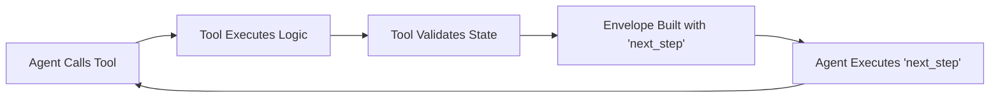
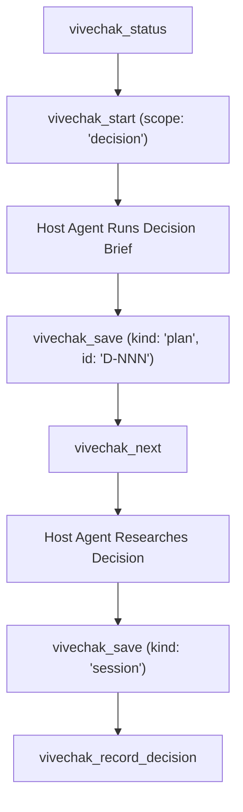
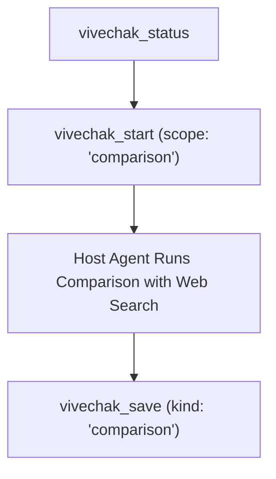

# MCP Tools Reference

> **Last verified against code:** 2026-10-21 (v0.1.0)
> Tool schemas and behaviors described here match `internal/mcp/server.go`. If you find discrepancies, please file an issue.

The Model Context Protocol (MCP) server for [Vivechak](../README.md) exposes 9 consolidated tools designed to run evidence-grounded research pipelines directly inside any MCP-compatible AI host, agent runtime, or IDE. Complete machine-facing documentation for the 9 tools is available in [`docs/reference/tools.md`](reference/tools.md).

Vivechak supports two execution models:
1. **MCP Server Workflow**: Autonomous or semi-autonomous execution where the host agent calls MCP tools to prepare prompts, manage DAG session progression, validate outputs, record ADRs, and verify Phase 0 exit gates.
2. **Manual Workflow**: Copying static generator prompts ([`GENERATOR-PROJECT.md`](../GENERATOR-PROJECT.md), [`GENERATOR-DECISION.md`](../GENERATOR-DECISION.md), [`GENERATOR-COMPARISON.md`](../GENERATOR-COMPARISON.md)) into browser-based AI chats and tracking markdown deliverables by hand.

---

## Architecture & Concepts

### Standardized Response Envelope

Every Vivechak tool returns a unified JSON envelope defined by [`Envelope`](../internal/mcp/envelope.go). The envelope standardizes execution status, payloads, advisory warnings, and procedural next steps:

```json
{
  "success": true,
  "message": "Session T1-01 saved as valid (0 warnings, 0 errors)",
  "data": { ... },
  "warnings": [],
  "next_step": "Run vivechak_next to get the next research session prompt.",
  "meta": {
    "api": 1,
    "tool": "vivechak_save",
    "truncated": false
  }
}
```

#### Envelope Field Specification

| Field | Type | Description |
|---|---|---|
| `success` | `boolean` | Indicates whether the tool operation completed without unhandled fatal errors. |
| `message` | `string` | Human-readable operational summary describing the outcome. |
| `data` | `object` | Tool-specific payload (varies by tool; omitted on certain error states). |
| `warnings` | `string[]` | Non-fatal advisory issues (e.g., missing evidence grades, oversized prompts, draft saves). |
| `next_step` | `string` | Actionable instructions prescribing what the AI agent should do next. |
| `meta.api` | `integer` | Envelope schema version (currently `1`). |
| `meta.tool` | `string` | Name of the tool that generated the response. |
| `meta.truncated` | `boolean` | Set to `true` if large payloads (e.g., prompts > 10,000 tokens) were truncated under default settings. |

#### Dual-Channel Delivery
Per [`Envelope.ToResult()`](../internal/mcp/envelope.go), the server delivers responses simultaneously via:
1. **`StructuredContent`**: Native MCP structured JSON payload for clients supporting JSON object inspection.
2. **`TextContent`**: Pretty-printed JSON string fallback in `Content` to prevent client parsing errors (e.g., Cursor drops structured-only responses; Gemini CLI rejects missing structured content).

#### Tool Error Handling
Per the MCP specification, runtime operational errors (such as missing required fields, invalid scopes, or uninitialized workspaces) are returned as tool execution results with `isError: true` via [`ErrorResult()`](../internal/mcp/envelope.go), preserving the envelope structure and providing remediation instructions in `next_step` instead of crashing the JSON-RPC connection.

---

### The Guided Worker Pattern

Vivechak tools do not just return raw data; they implement the **Guided Worker pattern**. Every response contains an explicit, deterministic `next_step` string that directs the host agent to the next logical action in the pipeline.



This prevents AI agents from getting stuck, drifting into unapproved tasks, or losing track of DAG dependencies across multi-turn context windows.

---

### Workspace Resolution Chain

Every tool that interacts with the filesystem resolves the workspace root directory using a 7-step resolution ladder via [`ResolveWorkspace()`](../internal/workspace/resolve.go):

1. **Explicit argument**: `project_root` parameter passed directly to the tool call.
2. **MCP client roots**: Workspace roots provided by the MCP client via `roots/list`.
3. **Environment variables**: Namespaced variables (`VIVECHAK_PROJECT_ROOT` -> `VCK_PROJECT_ROOT` -> `VIVECHAK_DEFAULT_ROOT` -> `VCK_DEFAULT_ROOT`), safely ignoring unexpanded `${workspaceFolder}` macros and generic unnamespaced variables like `WORKSPACE` or `PROJECT_ROOT` to protect container isolation per Principle P1.1.
4. **In-process session memory**: Retains the last successfully resolved workspace within the current server process, anchoring subsequent tool calls to the active project session.
5. **Marker walk-up from CWD**: Traversing upward from the current working directory (`CWD`) searching for `research/.vivechak.json` or an existing `research/` directory (skipping host IDE application folders).
6. **Guarded CWD**: Root project manifest anchor detection in the CWD (e.g. `package.json`, `go.mod`, `Cargo.toml`, `.git`).
7. **Fail-Closed Diagnostic**: If none succeed, returns `E-ROOT-UNRESOLVED` instructing the caller to start a research session (e.g. `/compare`, `/decision`, `/project`) or pass `project_root` explicitly.

---

## Tool Call Sequences by Scope Level

Vivechak operates across three distinct research scope levels defined in [`Scope`](../internal/core/scope.go):

### 1. Project Scope (Full Research Pipeline &rarr; FAD)
*Duration:* 4–30 sessions.  
*Outcome:* Full `RESEARCH-PIPELINE.md`, individual session outputs, architectural decisions, and a final Founding Architecture Document (`FAD.md`).```mermaid
flowchart TD
    S["vivechak_status"] --> ST["vivechak_start (scope: 'project')"]
    ST --> R1["Host Agent Runs Generator with Web Search"]
    R1 --> SP["vivechak_save (kind: 'plan')"]
    SP --> NS["vivechak_next"]
    NS --> R2["Host Agent Runs Session Prompt with Web Search"]
    R2 --> SS["vivechak_save (kind: 'session')"]
    SS --> RD["vivechak_record_decision"]
    RD --> Check{"More sessions in DAG?"}
    Check -- Yes --> NS
    Check -- No (SYN-01) --> SYN["vivechak_next (SYN-01)"]
    SYN --> RSYN["Host Agent Synthesizes FAD"]
    RSYN --> SSYN["vivechak_save (kind: 'fad')"]
    SSYN --> RG["vivechak_gate"]
```

**Step-by-step workflow:**
1. Call `vivechak_status` to orient and verify workspace presence.
2. Call `vivechak_start` with `scope: "project"` and your comprehensive project description in `question` to scaffold `research/` and generate the actionable DAG brief.
3. Run the returned generator prompt in a research session with live web search enabled.
4. Save the generated pipeline using `vivechak_save(kind: "plan", id: "DAG", content: ...)`.
5. Loop through sessions:
   - Call `vivechak_next` to receive the next dependency-cleared research prompt with upstream context injected.
   - Run the session prompt with web search enabled.
   - Save the raw session report using `vivechak_save(kind: "session", id: "<session_id>", content: ...)`.
   - Record any Architectural Decision Records (ADRs) produced in that session using `vivechak_record_decision(decision_id: "D-NNN", auto_draft_from: "<session_id>", auto_save: true)`.
6. When all research tracks finish, call `vivechak_next` for `SYN-01` (Synthesis). All prior session outputs are automatically aggregated into the prompt.
7. Persist the generated `research/FAD.md` using `vivechak_save(kind: "fad", id: "SYN-01", content: ...)`.
8. Call `vivechak_gate` (or CLI `vck gate`) to perform automated verification of the Phase 0 Exit Gate (Track A structural completeness and Track B mechanical quality).

*Manual Alternative:* Copy [`GENERATOR-PROJECT.md`](../GENERATOR-PROJECT.md), replace the placeholder with your project vision, run it in an AI web session, and manually save outputs to `research/RESEARCH-PIPELINE.md`.

#### Planning-Only (Deferred Execution Flow)
When the user wants to decompose and plan the architecture pipeline without executing research immediately (e.g. *"create research pipeline for X, do not run research yet"*):
1. `vivechak_start(scope="project", question="<project vision>")`
2. Host agent runs the generator prompt and synthesizes the session DAG and initial decisions.
3. `vivechak_save(kind="plan", id="DAG", content="<pipeline markdown>")`
4. `vivechak_status(format="mermaid")` (Optional: render Mermaid dependency graph for visual verification)
5. **STOP** — The agent reports the plan and pauses. It does **not** call `vivechak_next` until the user explicitly directs it to begin research.

---

### 2. Decision Scope (Single Architectural Decision &rarr; ADR)
*Duration:* 1–3 sessions.  
*Outcome:* Bounded decision plan and formal ADR (`D-xxx-decision.md`).



**Step-by-step workflow:**
1. Call `vivechak_status` to inspect workspace.
2. Call `vivechak_start` with `scope: "decision"` and `question: "<architectural dilemma>"`.
3. Execute the brief in a web research session.
4. Call `vivechak_save` with `kind: "plan"`, `id: "D-015"`, and the generated plan in `content`.
5. Execute research sessions via `vivechak_next` and `vivechak_save(kind: "session", ...)`.
6. Persist the resulting ADR via `vivechak_record_decision` with `decision_id: "D-015"` (or `auto_draft_from: "D-015-S1", auto_save: true`).

*Manual Alternative:* Copy [`GENERATOR-DECISION.md`](../GENERATOR-DECISION.md) into an AI session, inject context, and manually write ADRs to `research/D-xxx-decision.md`.

---

### 3. Comparison Scope (Bounded Options Comparison &rarr; WEP Matrix)
*Duration:* 1 session.  
*Outcome:* Weighted Evaluation Matrix (WEP) comparing 2–4 concrete technologies or architectures.



**Step-by-step workflow:**
1. Call `vivechak_start` with `scope: "comparison"` and `question: "<comparison question>"` (or specify `options` and `criteria`).
2. Run the returned comparison brief with live web search.
3. Call `vivechak_save` with `kind: "comparison"`, `id: "C-01"`, and the WEP matrix content to persist `research/comparisons/C-01.md`.
4. Done! 0 DAG overhead, 0 gate overhead.

*Manual Alternative:* Copy [`GENERATOR-COMPARISON.md`](../GENERATOR-COMPARISON.md), specify options, and paste output directly into `research/COMPARISON.md`.

---

### 4. Out of Scope (Direct Implementation & Coding)
Vivechak tools are purpose-built for evidence-grounded technical research, architecture, and technology comparisons. **Do NOT invoke MCP tools for:**
- Writing application source code, UI components, backend routes, or data models.
- Answering syntax, type definitions, or standard library API questions.
- Debugging stack traces, runtime exceptions, or compiler errors.
- Micro-refactoring, variable renaming, or file formatting.

When a user asks for code implementation or debugging, respond directly with code or troubleshooting advice without invoking any Vivechak MCP tools.

---

## Tools Reference

Vivechak exposes 9 consolidated MCP tools registered directly on the server (see [`docs/reference/tools.md`](reference/tools.md) for concise machine-facing contracts). Below is the comprehensive reference for all tool endpoints:

### 1. `vivechak_start`
**Title:** Start Research Workspace & Brief  
**Annotations:** Read-Only: `false` | Idempotent: `true` | Destructive: `false` | Open-World: `false`

#### Description
Entry point for all Vivechak operations. Initializes research workspace in the user's project and returns an executable research brief with an allocated identifier.

#### What It Does
1. Resolves the project workspace using the 7-step resolution chain and initializes the directory structure (`research/`, `research/sessions/`, `research/templates/`).
2. Copies scope-appropriate embedded templates: 6 for `project` scope, 2 for `decision` scope, or 1 for `comparison` scope.
3. Automatically infers scope from `question`/`context` if omitted (`core.InferScope`).
4. Generates a directly executable research brief with an allocated identifier (`C-01` for comparison, `D-001` for decision, or full session DAG decomposition for project scope).
5. For massive greenfield project scopes, supports progressive chunking via the `part` parameter (e.g. `part: 1`) to eliminate prompt truncation.

#### Input Parameters
Defined in [`StartInput`](../internal/mcp/tool_start.go):

| Parameter | Type | Required | Description |
|---|---|---|---|
| `project_root` | `string` | Optional | Workspace root path (optional; auto-discovered via resolution chain if omitted). |
| `scope` | `string` | Optional | Research scope: `comparison` (2–5 options) \| `decision` (single architectural decision/ADR) \| `project` (full system architecture DAG). Inferred from question if omitted. |
| `question` | `string` | Optional* | The technical dilemma, comparison options, or project vision. Alias: `context`. *(Either `question` or `context` should be provided).* |
| `context` | `string` | Optional | Additional project context, constraints, or architecture brief (alias for `question`). |
| `options` | `string[]` | Optional | Optional list of named options to compare (e.g. `["Pino", "Winston"]`). |
| `criteria` | `string` | Optional | Optional key evaluation criteria or constraints. |
| `part` | `integer` | Optional | Optional 1-based part index for multi-part delivery of large project briefs. |

#### Response (`data` field)
- `workspace_root` (`string`): Absolute filesystem path to the workspace root.
- `scope` (`string`): Selected or inferred research scope (`project`, `decision`, or `comparison`).
- `allocated_id` (`string`): Allocated deliverable identifier (`C-01`, `D-001`, or `DAG`).
- `brief` (`string`): The directly executable research brief containing hypotheses and evidentiary contracts.
- `generator_file` (`string`): Underlying generator template used.
- `char_count` (`integer`): Character count of the returned brief.
- `approx_tokens` (`integer`): Estimated token count.
- `part` (`integer`, optional): Current part number for multi-part project briefs.
- `total_parts` (`integer`, optional): Total parts available for multi-part project briefs.
- `templates_copied` (`string[]`): Names of the templates written to `research/templates/`.
- `directories_created` (`string[]`): Directories created on disk.

#### Example
**Request:**
```json
{
  "project_root": "d:/dev/pro/my-cloud-app",
  "scope": "comparison",
  "question": "Pino vs Winston for Node.js microservices with JSON logging"
}
```

**Response:**
```json
{
  "success": true,
  "message": "Initialized comparison workspace at d:/dev/pro/my-cloud-app (allocated ID: C-01)",
  "data": {
    "workspace_root": "d:/dev/pro/my-cloud-app",
    "scope": "comparison",
    "allocated_id": "C-01",
    "brief": "# Comparison Research Brief: Pino vs Winston\n...",
    "generator_file": "GENERATOR-COMPARISON.md",
    "char_count": 4120,
    "approx_tokens": 1030,
    "templates_copied": ["COMPARISON-SESSION.template.md"],
    "directories_created": ["research", "research/templates"]
  },
  "next_step": "Run research with web search following the brief above. Save the resulting WEP matrix via vivechak_save(kind='comparison', id='C-01', content=...).",
  "meta": {
    "api": 1,
    "tool": "vivechak_start"
  }
}
```

---

### 2. `vivechak_save`
**Title:** Save Research Artifact  
**Annotations:** Read-Only: `false` | Idempotent: `true` | Destructive: `false` | Open-World: `false`

#### Description
Validate and persist research deliverables (plans, sessions, comparison matrices, or founding architecture documents) into the workspace.

#### What It Does
Polymorphically validates and persists artifacts according to `kind` (or auto-infers `kind` from content/ID):
- `kind: "plan"`: Validates DAG acyclicity and persists `research/RESEARCH-PIPELINE.md`. If `decisions_content` is provided, compiles the initial decision stubs into `research/DECISIONS.md`.
- `kind: "session"`: Validates YAML frontmatter, required metadata, non-empty body, and inline evidence grades (`A-E`). Runs the real-time non-blocking **Quality Coaching Engine** (`ObserveSessionQuality`), surfacing `Q-*` feedback in `next_step`. Promotes valid sessions to `status: complete` and writes to `research/sessions/<id>.md`.
- `kind: "comparison"`: Validates Weighted Evaluation Protocol (WEP) matrix and persists `research/comparisons/<id>.md` (or `research/<id>-comparison.md`). Bypasses DAG constraints and gate checks.
- `kind: "fad"`: Validates terminal Map-Reduce synthesis, persists canonical `research/FAD.md`, and automatically mirrors `FOUNDING-ARCHITECTURE.md` to project root.

**Auto-Initialization:** If called on an uninitialized directory, `vivechak_save` automatically initializes the directory layout and templates on the fly, writing `research/.gitignore` (`*.lock`) to avoid blocking the caller.  
**Atomic Writes & Advisory Locking:** All writes use monotonic temporary files and cross-process advisory locks with 5-second timeouts to prevent race conditions during concurrent execution.

#### Input Parameters
Defined in [`SaveInput`](../internal/mcp/tool_save.go):

| Parameter | Type | Required | Description |
|---|---|---|---|
| `project_root` | `string` | Optional | Workspace root path. |
| `kind` | `string` | Optional | Artifact kind (auto-inferred if omitted): `plan` \| `session` \| `comparison` \| `fad`. |
| `id` | `string` | Optional | Identifier: session ID (e.g. `T1-01`, `SYN-01`) or comparison ID (e.g. `C-01`). Aliases: `session_id`, `decision_id`. |
| `content` | `string` | **Required** | Markdown artifact content to save. Alias: `pipeline_content`. |
| `decisions_content` | `string` | Optional | Initial decision registry or draft ADR content when saving a plan. |
| `slug` | `string` | Optional | URL-safe slug for the artifact filename (e.g. `database-selection`). |

#### Response (`data` field)
- `workspace_root` (`string`): Path to workspace root.
- `kind` (`string`): Artifact kind persisted.
- `id` (`string`): Session or deliverable ID.
- `file_path` (`string`): Relative output file path (e.g. `research/sessions/T1-01.md`).
- `root_copy` (`string`, optional): Relative path of mirrored human-facing copy (`FOUNDING-ARCHITECTURE.md`) for FAD synthesis.
- `saved_files` (`string[]`, optional): Array of relative paths written when saving plans.
- `status` (`string`): Validation status (`valid`, `valid-with-warnings`, or `draft`).
- `validation_passed` (`boolean`): Whether validation passed without blocking Level 2 issues.
- `validation` ([`ValidationResult`](../internal/core/validate.go)): Detailed validation report.
- `quality_observations` (`object[]`, optional): Advisory quality observations (`category`, `message`, `severity`).
- `progress` (`object`, optional): Real-time mini-status (`sessions_completed`, `sessions_total`, `decisions_recorded`).

#### Example
**Request:**
```json
{
  "kind": "session",
  "id": "T1-01",
  "content": "---\nsession_id: T1-01\ntitle: Distributed Cache Engine\ndate: 2026-10-30\nstatus: complete\n---\n\n## Findings\nRedis 7.2 demonstrates 110k ops/sec with sub-millisecond p99 latency [E-A: https://redis.io/benchmarks]. Dragonfly shows 2.5x higher throughput [E-B: whitepaper]."
}
```

**Response:**
```json
{
  "success": true,
  "message": "Session T1-01 saved as valid (0 warnings, 0 errors)",
  "data": {
    "workspace_root": "d:/dev/pro/my-cloud-app",
    "kind": "session",
    "id": "T1-01",
    "file_path": "research/sessions/T1-01.md",
    "status": "valid",
    "validation_passed": true,
    "validation": { "status": "valid" },
    "progress": {
      "sessions_completed": 1,
      "sessions_total": 4,
      "decisions_recorded": 0
    }
  },
  "next_step": "Run vivechak_next for the next research session, or vivechak_record_decision(decision_id='D-001', auto_draft_from='T1-01', auto_save=true) to record an ADR.",
  "meta": {
    "api": 1,
    "tool": "vivechak_save"
  }
}
```

---

### 3. `vivechak_record_decision`
**Title:** Record Decision (ADR)  
**Annotations:** Read-Only: `false` | Idempotent: `true` | Destructive: `false` | Open-World: `false`

#### Description
Save an Architectural Decision Record (ADR) or Analysis of Competing Hypotheses (ACH) conflict resolution. Classifies decisions as One-Way or Two-Way Doors and compiles the consolidated registry.

#### What It Does
1. Validates and persists canonical ADR markdown files to `research/D-NNN.md` (or `research/D-NNN-[slug].md`).
2. Evaluates required YAML frontmatter (`decision_id`, `title`, `status`, `door_type`) and substantive body content (>100 characters).
3. **Single-Source ADR Compiler:** Automatically discovers all canonical `D-*.md` files in `research/`, wraps frontmatter in collapsible `<details>` blocks, and atomically compiles the consolidated `research/DECISIONS.md` registry.
4. **One-Shot Auto-Drafting:** Supports `auto_draft_from: "<session_id>"` with `auto_save: true` to synthesize rationale, trade-offs, and citations from session findings into an ADR and persist it in a single atomic turn.
5. **Supersession & Lifecycle Management:** Supports `supersedes: "D-001"`, marking the previous decision as superseded, cross-linking records, and warning of stale downstream session references.

#### Input Parameters
Defined in [`RecordDecisionInput`](../internal/mcp/tool_record_decision.go):

| Parameter | Type | Required | Description |
|---|---|---|---|
| `project_root` | `string` | Optional | Workspace root path. |
| `artifact_type` | `string` | Optional | Type of artifact: `decision` (default) \| `conflict-resolution`. |
| `decision_id` | `string` | **Required*** | Decision identifier (e.g. `D-001`). Alias: `id`. *(Pass `decision_id` or `id`).* |
| `id` | `string` | Optional | Unified alias for `decision_id`. |
| `slug` | `string` | Optional | Optional slug for filename (e.g. `primary-database`). |
| `status` | `string` | Optional | Lifecycle status: `proposed` \| `accepted` \| `rejected` \| `deprecated` \| `superseded`. |
| `content` | `string` | Optional* | Complete Markdown content with YAML frontmatter. *(Omit when using `auto_draft_from`).* |
| `auto_draft_from` | `string` | Optional | Session ID to auto-draft decision from (e.g. `T1-01`). |
| `auto_save` | `boolean` | Optional | If `true` with `auto_draft_from`, automatically validates and saves the drafted ADR in one turn. |
| `supersedes` | `string` | Optional | ID of decision being superseded (e.g. `D-001`). |

#### Response (`data` field)
- `workspace_root` (`string`): Workspace path.
- `decision_id` (`string`): Decision identifier.
- `artifact_type` (`string`): `decision` or `conflict-resolution`.
- `file_path` (`string`): Path to the written canonical ADR file.
- `status` (`string`): Validation status (`valid`, `valid-with-warnings`, or `draft`).
- `registry_updated` (`boolean`): Whether `research/DECISIONS.md` was recompiled.
- `supersedes` (`string`, optional): Superseded decision ID.
- `superseded_file` (`string`, optional): Path to updated superseded ADR artifact.
- `progress` (`object`): Real-time tracker (`sessions_completed`, `decisions_recorded`).
- `validation` ([`ValidationResult`](../internal/core/validate.go)): Detailed validation report.

#### Example
**Request:**
```json
{
  "decision_id": "D-001",
  "auto_draft_from": "T1-01",
  "auto_save": true
}
```

**Response:**
```json
{
  "success": true,
  "message": "Saved decision D-001 as valid; updated DECISIONS.md registry",
  "data": {
    "workspace_root": "d:/dev/pro/my-cloud-app",
    "decision_id": "D-001",
    "artifact_type": "decision",
    "file_path": "research/D-001-distributed-cache-engine.md",
    "status": "valid",
    "registry_updated": true,
    "progress": {
      "sessions_completed": 1,
      "decisions_recorded": 1
    },
    "validation": { "status": "valid" }
  },
  "next_step": "Run vivechak_next to get the next research session prompt, or vivechak_status to review overall progress.",
  "meta": {
    "api": 1,
    "tool": "vivechak_record_decision"
  }
}
```

---

### 4. `vivechak_next`
**Title:** Get Next Research Session  
**Annotations:** Read-Only: `true` | Idempotent: `true` | Destructive: `false` | Open-World: `false`

#### Description
Return the next actionable research session prompt with upstream findings automatically injected into context slots. Resolves DAG dependencies and topological order.

#### What It Does
1. Parses `research/RESEARCH-PIPELINE.md` into an in-memory DAG and checks `research/sessions/` for completed deliverables.
2. Identifies unblocked sessions whose upstream dependencies are satisfied using Kahn's topological sort algorithm.
3. Automatically extracts findings from completed ancestor sessions and injects them directly into the session prompt's context slots.
4. Identifies other unblocked sessions that can execute in parallel, surfacing concurrency opportunities in `other_ready_sessions` and `parallelism_hint`.
5. For synthesis sessions (`SYN-01` / `FAD`), aggregates all finalized session findings across the pipeline.
6. When all research sessions are complete, transitions guidance directly to `SYN-01` or `vivechak_gate`.

#### Input Parameters
Defined in [`NextInput`](../internal/mcp/tool_next.go):

| Parameter | Type | Required | Description |
|---|---|---|---|
| `project_root` | `string` | Optional | Workspace root path. |
| `session_id` | `string` | Optional | Specific session ID to retrieve (optional; returns next ready session if omitted). Aliases: `id`. |
| `id` | `string` | Optional | Unified alias for `session_id` (e.g. `T1-02`). |
| `verbose` | `boolean` | Optional | If `true`, include full upstream findings without truncating prompts over 10K tokens. |

#### Response (`data` field)
When an actionable session is ready:
- `session_id` (`string`): Session identifier (e.g. `T1-02`).
- `title` (`string`): Session title.
- `layer` (`integer`): DAG execution layer.
- `door_type` (`string`): Reversibility classification (`one-way` or `two-way`).
- `decision_ref` (`string`): Associated ADR ID (e.g. `D-002`).
- `dependencies` (`string[]`): Upstream session IDs.
- `output_file` (`string`): Expected output path (`research/sessions/T1-02.md`).
- `total_sessions` / `completed_sessions` (`integer`): DAG progress metrics.
- `prompt` (`string`): Fully assembled prompt with upstream context injected and active research calibration rules appended.
- `prompt_char_count` / `prompt_approx_tokens` (`integer`): Token and character metrics.
- `other_ready_sessions` (`string[]`, optional): Other unblocked sessions ready for parallel execution.
- `parallelism_hint` (`string`, optional): Advisory guidance on concurrent subagent opportunities.

When all sessions are finished:
- `all_complete` (`boolean`): `true`.
- `total_sessions` / `completed_sessions` (`integer`).

When sessions remain blocked by unmet dependencies:
- `blocked_sessions` (`object[]`): Remaining sessions and their blocker dependencies (`[{"session_id": "T2-01", "blocked_by": ["T1-01"]}]`).

#### Example
**Request:**
```json
{
  "project_root": "d:/dev/pro/my-cloud-app"
}
```

**Response:**
```json
{
  "success": true,
  "message": "Session T1-02: Message Broker Selection (1/4 complete)",
  "data": {
    "session_id": "T1-02",
    "title": "Message Broker Selection",
    "layer": 1,
    "door_type": "one-way",
    "decision_ref": "D-002",
    "dependencies": ["T0-01"],
    "output_file": "research/sessions/T1-02.md",
    "total_sessions": 4,
    "completed_sessions": 1,
    "prompt": "## BRIEF\nEvaluate Kafka vs NATS vs RabbitMQ...\n\n## UPSTREAM CONTEXT (from T0-01)\nRedis selected for session caching.\n\n## DELIVERABLE\nProduce session report with evidence grades.",
    "prompt_char_count": 2840,
    "prompt_approx_tokens": 710,
    "other_ready_sessions": ["T1-03"]
  },
  "next_step": "Execute the prompt for session T1-02 in a fresh session with web search. Save output with vivechak_save(kind='session', id='T1-02', content=...). Also ready: T1-03 (can run in parallel).",
  "meta": {
    "api": 1,
    "tool": "vivechak_next"
  }
}
```

---

### 5. `vivechak_status`
**Title:** Research Workspace Status & Visualization  
**Annotations:** Read-Only: `true` | Idempotent: `true` | Destructive: `false` | Open-World: `false`

#### Description
Scan workspace and report research progress, session health, or render visual DAG flowcharts and comparison diagrams.

#### What It Does
1. Inspects the workspace filesystem to verify initialization status, active research scope, completed sessions count, and ADR count.
2. If uninitialized, returns cleanly with `initialized: false` and guides initialization without raising fatal errors.
3. Supported formats:
   - `summary` (default): Concise overview of workspace health, session counts, progress percentage, and next recommended actions.
   - `mermaid`: Renders the session DAG flowchart (or comparison criteria matrix) with color-coded execution states (green = completed, amber = unblocked/ready, gray = blocked, blue = grand synthesis).
   - `json`: Structured metrics and dependency node mappings for tool integrations.

#### Input Parameters
Defined in [`StatusInput`](../internal/mcp/tool_status.go):

| Parameter | Type | Required | Description |
|---|---|---|---|
| `project_root` | `string` | Optional | Workspace root path. |
| `format` | `string` | Optional | Output format: `summary` (default) \| `mermaid` (visual flowchart) \| `json`. |

#### Response (`data` field)
When initialized:
- `root` (`string`): Absolute path to workspace root.
- `initialized` (`boolean`): `true`.
- `has_pipeline` (`boolean`): Whether `research/RESEARCH-PIPELINE.md` exists.
- `has_decisions` (`boolean`): Whether `research/DECISIONS.md` exists.
- `session_count` (`integer`): Completed `.md` sessions in `research/sessions/`.
- `template_count` (`integer`): Active template count in `research/templates/`.
- `scope` (`string`): Inferred scope (`project`, `decision`, or `comparison`).
- `rendering` (`string`, when `format="mermaid"`): Rendered Mermaid diagram.
- `ready_sessions` (`string[]`): Sessions currently unblocked and ready to run.
- `blocked_sessions` (`string[]`): Sessions waiting on dependencies.

When uninitialized:
- `initialized` (`boolean`): `false`.
- `status` (`string`): `"uninitialized"`.

#### Example
**Request:**
```json
{
  "format": "summary"
}
```

**Response:**
```json
{
  "success": true,
  "message": "Workspace at d:/dev/pro/my-cloud-app: 2/4 sessions completed (50%), 1 decision recorded",
  "data": {
    "root": "d:/dev/pro/my-cloud-app",
    "initialized": true,
    "has_pipeline": true,
    "has_decisions": true,
    "session_count": 2,
    "template_count": 6,
    "scope": "project",
    "ready_sessions": ["T1-03"],
    "blocked_sessions": ["SYN-01"]
  },
  "next_step": "Run vivechak_next to retrieve prompt for ready session T1-03.",
  "meta": {
    "api": 1,
    "tool": "vivechak_status"
  }
}
```

---

### 6. `vivechak_review`
**Title:** Review Research (Validate or Challenge)  
**Annotations:** Read-Only: `true` | Idempotent: `true` | Destructive: `false` | Open-World: `false`

#### Description
Inspect research artifacts for quality validation or adversarial stress-testing.

#### What It Does
Offers two complementary modes:
- **`mode: "validate"` (Quality Validation):**
  - Executes dry-run validation against session outputs, ADRs, research plans, comparison matrices, or FAD synthesis without modifying files on disk.
  - Returns structural issues (Level 2 blocking) and quality warnings (Level 3 advisory) with actionable fix hints.
  - **Workspace Mode:** When `content` is omitted and `project_root` is provided, automatically discovers and audits every deliverable across the workspace.
- **`mode: "challenge"` (Adversarial Red-Team Challenge):**
  - Implements Principle P8 (Structured Falsification) for One-Way Doors.
  - Analyzes a session artifact, standalone ADR, or comparison matrix and generates targeted adversarial challenge prompts (`premortem`, `falsification`, `red_team`) to test assumptions and uncover latent failure modes.

#### Input Parameters
Defined in [`ReviewInput`](../internal/mcp/tool_review.go):

| Parameter | Type | Required | Description |
|---|---|---|---|
| `project_root` | `string` | Optional | Workspace root path. |
| `mode` | `string` | Optional | Review mode: `validate` (default quality ladder) \| `challenge` (adversarial red-team stress test). |
| `challenge_type` | `string` | Optional | Specific challenge angle: `premortem` \| `falsification` \| `red_team`. |
| `target` | `string` | Optional | Target session ID (e.g. `T1-01`), decision ID (e.g. `D-001`), or artifact path. Aliases: `id`, `session_id`, `decision_id`. |
| `artifact_type` | `string` | Optional | What to validate: `session` \| `decision` \| `decisions` \| `plan` \| `comparison` \| `fad` (omit for workspace audit). |
| `content` | `string` | Optional | Content to validate (dry run); omit for workspace-wide validation or saved artifact review. |

#### Response (`data` field)
In validate mode:
- `artifact_type` (`string`): Artifact type evaluated.
- `status` (`string`): Validation status (`valid`, `valid-with-warnings`, `draft`, or `invalid`).
- `error_count` / `warning_count` (`integer`): Counts of blocking errors and advisory warnings.
- `validation` ([`ValidationResult`](../internal/core/validate.go)): Detailed issues list with level, code, message, and fix hints.

In challenge mode:
- `session_id` (`string`): Evaluated session or decision identifier.
- `mode` (`string`): Challenge angle utilized.
- `recommendation` (`string`): Recommendation extracted from artifact.
- `challenge_prompts` (`object[]`): Generated adversarial challenge prompts with type and rationale.
- `context` (`object`): Evidentiary context (`door_type`, `evidence_grades`, `rejected_alts`).

#### Example
**Request:**
```json
{
  "mode": "challenge",
  "target": "D-001",
  "challenge_type": "premortem"
}
```

**Response:**
```json
{
  "success": true,
  "message": "Generated premortem challenge prompts for D-001",
  "data": {
    "session_id": "D-001",
    "mode": "premortem",
    "recommendation": "Adopt Redis Cluster for session persistence",
    "challenge_prompts": [
      {
        "type": "premortem",
        "prompt": "Fast forward 12 months: Redis Cluster has experienced major outage or scaling collapse. Identify top 3 operational failure modes...",
        "rationale": "One-Way Doors require explicit failure mode post-mortems before commitment"
      }
    ]
  },
  "next_step": "Execute the challenge prompt in an AI session with web search to stress-test your decision before locking.",
  "meta": {
    "api": 1,
    "tool": "vivechak_review"
  }
}
```

---

### 7. `vivechak_amend`
**Title:** Amend Research Session or Decision  
**Annotations:** Read-Only: `false` | Idempotent: `false` | Destructive: `false` | Open-World: `false`

#### Description
Append a post-hoc amendment note to an existing session, decision, or comparison matrix while preserving original findings and identifying downstream stale sessions.

#### What It Does
1. Appends a structured amendment section (`## Post-Hoc Amendment (appended by <amending_session_id>)`) with timestamp, reason, and updated findings to the specified session, standalone ADR (`D-*.md`), or comparison matrix (`C-*.md`).
2. Two-Tier Lookup: Searches `research/sessions/` first, then searches `research/` directly for standalone ADRs and comparisons.
3. Automatically scans DAG topology to identify completed downstream sessions that depended on the amended findings, alerting the user to potential staleness.
4. **Registry Recompilation:** When amending a standalone ADR (`research/D-*.md`), automatically updates and recompiles the consolidated `research/DECISIONS.md` registry.
5. **Root Mirror Sync:** When amending synthesis deliverables (`SYN-01`, `FAD`), atomically updates both `research/FAD.md` and the human-facing root `FOUNDING-ARCHITECTURE.md`.

#### Input Parameters
Defined in [`AmendInput`](../internal/mcp/tool_amend.go):

| Parameter | Type | Required | Description |
|---|---|---|---|
| `project_root` | `string` | Optional | Workspace root path. |
| `session_id` | `string` | **Required*** | Target session ID, ADR ID, or comparison ID to amend (e.g. `T1-01`, `D-001`, `C-01`). Aliases: `target`, `id`. |
| `amending_session_id` | `string` | Optional | Session ID that discovered the amendment (optional, for traceability). |
| `amendment` | `string` | Optional* | Amendment content to append. Aliases: `content`, `append_content`, `append`. *(Pass `amendment` or alias).* |
| `reason` | `string` | Optional | Optional reason or summary for the amendment. |

#### Response (`data` field)
- `workspace_root` (`string`): Workspace path.
- `session_id` (`string`): Target session or ADR identifier.
- `file_path` (`string`): Relative output file path.
- `root_copy` (`string`, optional): Relative path of mirrored human-facing copy (`FOUNDING-ARCHITECTURE.md`) when amending FAD.
- `registry_recompiled` (`string`, optional): Path to `research/DECISIONS.md` when an ADR amendment triggered registry recompilation.
- `amendment_timestamp` (`string`): RFC3339 timestamp of the amendment.
- `amending_session_id` (`string`, optional): Source session attribution.
- `potentially_stale_sessions` (`string[]`, optional): Completed downstream sessions in the DAG affected by the amendment.

#### Example
**Request:**
```json
{
  "session_id": "T1-01",
  "amendment": "Load tests reveal Redis memory overhead is 25% higher under telemetry payload schemas. Adjust cluster sizing by 1.25x.",
  "reason": "Empirical load testing under high concurrency"
}
```

**Response:**
```json
{
  "success": true,
  "message": "Appended amendment to T1-01 (1 downstream sessions may be stale)",
  "data": {
    "workspace_root": "d:/dev/pro/my-cloud-app",
    "session_id": "T1-01",
    "file_path": "research/sessions/T1-01.md",
    "amendment_timestamp": "2026-10-30T04:00:00Z",
    "potentially_stale_sessions": ["T1-02"]
  },
  "next_step": "Review potentially stale downstream sessions (T1-02) or continue research.",
  "meta": {
    "api": 1,
    "tool": "vivechak_amend"
  }
}
```

---

### 8. `vivechak_replan`
**Title:** Replan Active Research Pipeline  
**Annotations:** Read-Only: `false` | Idempotent: `false` | Destructive: `false` | Open-World: `false`

#### Description
Modify an active research pipeline DAG mid-flight without losing completed work.

#### What It Does
Safely mutates DAG topology in `research/RESEARCH-PIPELINE.md` when new findings uncover new architectural branches or invalidate prior assumptions:
- `add_session`: Inserts a new session node into the graph with defined dependencies, door type, and research prompt.
- `remove_session`: Prunes an uncompleted session. Safely rejects deletion if completed sessions depend on it.
- `update_deps`: Updates upstream dependency list for an uncompleted session.
- `update_prompt`: Replaces the research prompt text of an uncompleted session.

**Integrity Verification:** The entire mutated DAG is verified using `core.DAG.ValidateDAG()` (detecting cycles, broken dependencies, and orphaned nodes) before writing changes back to disk with full round-trip formatting fidelity.

#### Input Parameters
Defined in [`ReplanInput`](../internal/mcp/tool_replan.go):

| Parameter | Type | Required | Description |
|---|---|---|---|
| `project_root` | `string` | Optional | Workspace root path. |
| `operation` | `string` | Optional | Mutation operation: `add_session` \| `remove_session` \| `update_deps` \| `update_prompt` (omit to receive guided overview of uncompleted sessions). |
| `session_id` | `string` | Optional* | Target session ID (e.g. `T1-02`; required when executing a mutation). |
| `reason` | `string` | Optional | Contextual finding or organizational change triggering the replan. |
| `impact` | `string` | Optional | Expected impact on pipeline topology or affected sessions. |
| `topic` | `string` | Optional* | Session title/topic (required for `add_session`). |
| `layer` | `string` | Optional | DAG execution layer (e.g. `"1"` for `add_session`). |
| `door_type` | `string` | Optional | Decision irreversibility: `one-way` or `two-way` (default: `two-way`). |
| `dependencies` | `string` | Optional | Comma-separated upstream dependency IDs (e.g. `"T0-01, T0-02"`). |
| `decision_ref` | `string` | Optional | Informed decision ID (e.g. `"D-001"` for `add_session`). |
| `prompt` | `string` | Optional | Research prompt markdown (for `add_session`). |
| `new_prompt` | `string` | Optional | Replacement prompt markdown (for `update_prompt`). |
| `new_dependencies` | `string` | Optional | Replacement comma-separated dependencies (for `update_deps`). |

#### Response (`data` field)
- `operation` (`string`): Performed operation (or `available_operations` in guided mode).
- `session_id` (`string`, optional): Target session ID.
- `total_sessions` (`integer`, optional): Updated total session count in the pipeline DAG.
- `uncompleted_sessions` (`string[]`, in guided mode): List of uncompleted sessions available for replanning.
- `reason` / `impact` (`string`, optional): Preserved rationale and impact metadata.

#### Example
**Request:**
```json
{
  "operation": "add_session",
  "session_id": "T1-04",
  "topic": "Distributed Tracing Backend Selection",
  "layer": "1",
  "dependencies": "T0-01",
  "door_type": "two-way",
  "prompt": "Evaluate Jaeger vs OpenTelemetry Collector vs Tempo...",
  "reason": "Observability requirements identified during caching review"
}
```

**Response:**
```json
{
  "success": true,
  "message": "Added session T1-04 to pipeline DAG (5 total sessions)",
  "data": {
    "operation": "add_session",
    "session_id": "T1-04",
    "total_sessions": 5,
    "reason": "Observability requirements identified during caching review"
  },
  "next_step": "Run vivechak_next to retrieve the next unblocked research session.",
  "meta": {
    "api": 1,
    "tool": "vivechak_replan"
  }
}
```

---

### 9. `vivechak_gate`
**Title:** Run Phase 0 Exit Gate  
**Annotations:** Read-Only: `false` | Idempotent: `true` | Destructive: `false` | Open-World: `false`

#### Description
Mechanically evaluate Phase 0 pre-coding exit criteria across Track A (Two-Way Doors) and Track B (One-Way Doors). Evaluates 12 rules (G1–G12) and auto-persists `research/PHASE-0-GATE.md` preserving human sign-offs.

#### What It Does
Performs automated verification of exit criteria before coding starts:
- **Track A (Two-Way Doors):** Fast-track reversibility confirmation. Two-Way Door decisions pass on Track A reversibility confirmation alone, authorizing immediate implementation without blocking on unrelated One-Way Door reviews.
- **Track B (One-Way Doors):** Deep evidentiary and structural verification across rules G1–G12:
  - G1: Pipeline file (`RESEARCH-PIPELINE.md`) exists.
  - G2: Synthesis document (`FAD.md`) exists.
  - G3: Operational templates present.
  - G4: Pipeline significance (minimum 3 completed sessions for project scope).
  - G5: Canonical ADR registry (`DECISIONS.md`) non-empty.
  - G6: Reversal triggers specified for all One-Way Doors.
  - G7: All decisions in final state (`accepted` or `rejected`).
  - G8: Evidentiary backing (Grade A/B evidence required for One-Way Doors).
  - G9: Verification method qualified (fetched or cached sources, model recall capped at Grade D).
  - G10: Rejected alternatives documented (minimum 30 characters).
  - G11: Adversarial red-team challenge conducted before commitment.
  - G12: Premortem and failure post-mortem documented.
- **Auto-Persistence:** Automatically generates or updates `research/PHASE-0-GATE.md`, preserving interactive human sign-offs recorded via CLI (`vck signoff`).

#### Input Parameters
Defined in [`GateInput`](../internal/mcp/tool_gate.go):

| Parameter | Type | Required | Description |
|---|---|---|---|
| `project_root` | `string` | Optional | Workspace root path. |
| `track` | `string` | Optional | Optional track filter: `all` (default) \| `track_a` (Two-Way Doors) \| `track_b` (One-Way Doors). |
| `verbose` | `boolean` | Optional | If `true`, return full check details and issue breakdown. |

#### Response (`data` field)
- `workspace_root` (`string`): Workspace path.
- `scope` (`string`): Workspace scope (`project`, `decision`, or `comparison`).
- `gate_status` (`string`): Overall gate verdict: `PASS`, `WARN`, or `FAIL`.
- `gate_passed` (`boolean`): `true` only if all evaluated checks pass.
- `track_a_result` (`string`): Two-Way Door fast-track result (`"PASS"` or `"FAIL"`).
- `track_b_result` (`string`): One-Way Door rigorous gate result (`"PASS"` or `"FAIL"`).
- `track_filter` (`string`): Evaluated track filter (`"track_a"`, `"track_b"`, or `"all"`).
- `decisions` (`object[]`): Collected ADR decisions evaluated (`id`, `title`, `door_type`, `status`).
- `structural_checks` (`object`): Breakdown of structural pipeline completeness.
- `quality_checks` (`object`): Breakdown of mechanical quality indicators (G1–G12).
- `gate_artifact` (`string`): Relative path to auto-persisted checklist (`research/PHASE-0-GATE.md`).
- `scope_note` (`string`): Explicit note regarding host architect's semantic quality responsibility.

#### Example
**Request:**
```json
{
  "project_root": "d:/dev/pro/my-cloud-app",
  "track": "all",
  "verbose": true
}
```

**Response:**
```json
{
  "success": true,
  "message": "Phase 0 Gate: PASS (Structural Completeness: 5/5, Quality Indicators: 4/4)",
  "data": {
    "workspace_root": "d:/dev/pro/my-cloud-app",
    "scope": "project",
    "gate_status": "PASS",
    "gate_passed": true,
    "track_a_result": "PASS",
    "track_b_result": "PASS",
    "track_filter": "all",
    "structural_checks": {
      "label": "Structural Completeness",
      "passed": true,
      "score": "5/5",
      "issues": []
    },
    "quality_checks": {
      "label": "Quality Indicators (Mechanical)",
      "passed": true,
      "score": "4/4",
      "issues": []
    },
    "gate_artifact": "research/PHASE-0-GATE.md"
  },
  "warnings": [],
  "next_step": "Gate passed! The research phase is complete. You can now begin implementation.",
  "meta": {
    "api": 1,
    "tool": "vivechak_gate"
  }
}
```

---

## Validation Ladder & Warning Codes Reference

Vivechak organizes all artifact validation into a 4-level validation ladder defined in [`ValidationLevel`](../internal/core/validate.go):

| Level | Identifier | Behavior |
|---|---|---|
| **L1** | `L1-CONSTRUCT` | Auto-fills or suggests defaults for cosmetic omissions (e.g., defaults missing `status` to `draft`). Lowest severity. |
| **L2** | `L2-BLOCK` | Blocks marking the session or decision as valid. Files are saved as `draft`. Must be resolved before Phase 0 completion. |
| **L3** | `L3-WARN` | Advisory warnings adhering to the comply-or-explain principle. Files are saved as `valid-with-warnings`. |
| **L4** | `L4-GATE` | Evaluated project-wide by `vivechak_gate`. Checks structural completeness and quality across all research files. |

### Validation Code Catalog

| Issue Code | Level | Emitted By | Description & Fix Hint |
|---|---|---|---|
| `V-INVALID-FRONTMATTER` | L2 | `vivechak_save`, `vivechak_record_decision`, `vivechak_review` | YAML frontmatter cannot be parsed. Check YAML indentation and syntax. |
| `V-MISSING-FRONTMATTER` | L2 | `vivechak_save`, `vivechak_record_decision`, `vivechak_review` | Document lacks leading `---` frontmatter block. Add required YAML frontmatter. |
| `V-MISSING-FIELD` | L2 | `vivechak_save`, `vivechak_record_decision`, `vivechak_review` | A required field (`session_id`, `title`, `date`, `status`) is absent. |
| `V-EMPTY-BODY` | L2 | `vivechak_save`, `vivechak_review` | Markdown document body after frontmatter is empty. |
| `V-MISSING-STATUS` | L1 | `vivechak_save`, `vivechak_review` | No `status` field provided; server constructs `status: draft`. |
| `W-NO-EVIDENCE-GRADES` | L3 | `vivechak_save`, `vivechak_record_decision`, `vivechak_review`, `vivechak_gate` | No inline evidence grades matching `[A-E] (...)` detected. Add citations. |
| `W-RECALLED-GRADE-CAP` | L3 | `vivechak_save`, `vivechak_record_decision`, `vivechak_review`, `vivechak_gate` | Recalled knowledge capped at Grade D per P3. Downgrade or corroborate with live/cached sources. |
| `W-MISSING-DOOR-TYPE` | L3 | `vivechak_record_decision`, `vivechak_review` | ADR or conflict resolution lacks `door_type` frontmatter. Specify `door_type: one-way` or `two-way`. |
| `W-SHORT-DECISION` | L3 | `vivechak_record_decision`, `vivechak_review` | ADR body length is less than 100 characters. Expand Context and Consequences. |
| `W-SHORT-BODY` | L3 | `vivechak_record_decision`, `vivechak_review` | Conflict resolution or artifact body length is less than 100 characters. |
| `W-MISSING-WEP-MATRIX` | L3 | `vivechak_review` | Comparison artifact lacks a structured Weighted Evaluation Protocol matrix table. |
| `W-OUTPUT-SIZE` | L3 | `vivechak_next` | Assembled prompt exceeds 10,000 tokens. Truncated unless `verbose: true`. |
| `W-STALE-DOWNSTREAM` | L3 | `vivechak_amend` | Amended session has completed downstream dependents; findings may be based on stale assumptions. |
| `W-STALE-DECISION-REFERENCE` | L3 | `vivechak_record_decision` | Superseded decision is referenced by existing completed sessions. |
| `W-TEMPLATE-MISSING` | L3 | `vivechak_start` | A template file could not be read from embedded binary assets. |
| `W-PLACEHOLDER-REMAINS` | L3 | `vivechak_save`, `vivechak_record_decision`, `vivechak_review` | Proposed ADR draft contains unexpanded placeholders. Informational during drafting; replace before accepting. |
| `W-LOCK-TIMEOUT` | L3 | `vivechak_save`, `vivechak_amend` | Root FAD mirror lock acquisition timed out under high concurrency; primary `research/FAD.md` safely persisted. |
| `E-PLACEHOLDER-REMAINS` | L2 | `vivechak_record_decision`, `vivechak_review`, `vivechak_gate` | Accepted ADR or FAD contains unexpanded bracketed template tokens. Replace with empirical findings before locking ADR. |
| `GATE-STRUCTURAL: <check>` | L4 | `vivechak_gate` | Structural completeness check failed (missing pipeline, FAD, templates, or uncompleted DAG sessions). |
| `GATE-QUALITY: <check>` | L4 | `vivechak_gate` | Mechanical quality check failed (<3 sessions, un-graded FAD, unfinalized decisions / missing reversal triggers, or One-Way Door B3/B4/B5 defects). |
| `GATE-ADVISORY: <check>` | L4 | `vivechak_gate` | Non-blocking observations (e.g. human review recommendation, structural ADR shape). |
| `Q-EVIDENCE` | Advisory | `vivechak_save` | Grade A claims lack canonical URL or RFC provenance anchors, or Grade A "fetched" citation lacks URL. |
| `Q-CONCERNS` | Advisory | `vivechak_save` | Missing `## Discovered Concerns` section. Research should uncover unexpected findings beyond stated scope. |
| `Q-DEPTH` | Advisory | `vivechak_save` | Fewer than 3 key findings in session output. Sessions typically benefit from 4-7 findings. |
| `Q-BIAS` | Advisory | `vivechak_save` | Delta section has 0 contradicted, refined, or updated prior beliefs, or deltas start exclusively from "Unknown" (P8 confirmation bias warning). |
| `Q-RIGOR` | Advisory | `vivechak_save` | Recommendation lacks explicit reference to rejected alternatives. |
| `Q-FRESHNESS` | Advisory | `vivechak_save` | References to potentially stale dates detected (with exclusion of port numbers, latencies, RAM). |
| `Q-DENSITY` | Advisory | `vivechak_save` | Substantive session cites fewer than 2 distinct external sources (Principle P3 citation diversity). |

---

## Best Practices for Host AI Agents

1. **Always Orient First:** Call `vivechak_status` at the beginning of any session. This establishes whether a workspace exists, which sessions have been completed, and what action is expected next.
2. **Follow `next_step`:** Do not invent your own directory structures or try to write files manually when MCP tools exist. The `next_step` instruction in each envelope points to the exact tool call required next.
3. **Use Live Web Search:** Research prompts emitted by `vivechak_start` and `vivechak_next` are explicitly designed for models with active web search tools. Always run them in sessions where web retrieval is active.
4. **Include Evidence Grades:** When writing research findings and saving them via `vivechak_save`, grade every substantive claim using Vivechak's evidence scale (e.g., `A (official documentation)`, `B (peer-reviewed benchmark)`, `C (community experience reports)`). This ensures zero `W-NO-EVIDENCE-GRADES` warnings and clean passage of the Phase 0 Exit Gate.
5. **Separate ADRs:** When a research session reaches a conclusion on an architectural trade-off, call `vivechak_record_decision` immediately after `vivechak_save` to maintain an up-to-date registry in `research/DECISIONS.md`.

---

## MCP Protocol Triumvirate: Prompts & Resources

In addition to the 9 consolidated model-controlled orchestration tools, Vivechak implements the complete Model Context Protocol specification with first-class **Prompts** (`prompts/list`, `prompts/get`) and **Resources** (`resources/list`, `resources/read`).

### 1. Native MCP Prompts (User-Controlled Workflows)

MCP Prompts allow users to trigger pre-calibrated research workflows via native slash commands in MCP-compatible clients (Claude Desktop, Cursor, Continue, Zed):

| Prompt Name | UI Title | Arguments | Description |
|---|---|---|---|
| `compare` *(aliases: `vivechak_compare`, `vck_compare`)* | Compare Options (WEP Matrix) | `options` (req), `criteria` (opt), `context` (opt) | Launches a bounded 1-session technology comparison (~5m) with anti-spill directives to persist the WEP matrix via `vivechak_save(kind="comparison")`. |
| `decision` *(aliases: `vivechak_decision`, `vck_decision`)* | Architectural Decision (ADR) | `dilemma` (req), `context` (opt) | Launches an architectural dilemma research plan (~30m, 1–3 sessions) leading to a canonical ADR. |
| `project` *(aliases: `vivechak_project`, `vck_project`)* | Project Pipeline (Full FAD) | `vision` (req), `context` (opt) | Launches a greenfield system decomposition across an adaptive dependency DAG to a Founding Architecture Document (`FAD.md`). |
| `gate` *(aliases: `vivechak_gate`, `vck_gate`)* | Phase 0 Pre-Codebase Exit Gate | `track` (opt: all/track_a/track_b), `project_root` (opt) | Prompts the model to evaluate pre-codebase exit criteria via `vivechak_gate` and summarize blocking issues. |

### 2. Canonical MCP Resources (`vivechak://...`)

MCP Resources allow AI models and host applications to directly reference Vivechak's canonical schemas and methodology reference cards without invoking execution tools:

| Resource URI | MIME Type | Description |
|---|---|---|
| `vivechak://templates/decisions` | `text/markdown` | Architecture Decision Record (ADR) canonical YAML frontmatter template (`DECISIONS.template.md`). |
| `vivechak://templates/comparison` | `text/markdown` | Weighted Evaluation Protocol (WEP) comparison matrix template (`COMPARISON-SESSION.template.md`). |
| `vivechak://templates/fad` | `text/markdown` | Founding Architecture Document (FAD) terminal synthesis template (`FOUNDING-ARCHITECTURE.template.md`). |
| `vivechak://templates/conflict-resolution` | `text/markdown` | Analysis of Competing Hypotheses (ACH) conflict resolution template (`CONFLICT-RESOLUTION.template.md`). |
| `vivechak://templates/gate` | `text/markdown` | Phase 0 Pre-Codebase Exit Gate checklist template (`PHASE-0-GATE.template.md`). |
| `vivechak://templates/session` | `text/markdown` | Standard research session output format with Prior, Delta, and Evidence Ledger (`SESSION.template.md`). |
| `vivechak://methodology/grades` | `text/markdown` | Evidence Grading Taxonomy reference card (definitions for Grades A–E, modifiers, and verification methods). |
| `vivechak://methodology/principles` | `text/markdown` | Core Methodology Principles reference card (principles P1–P8). |

