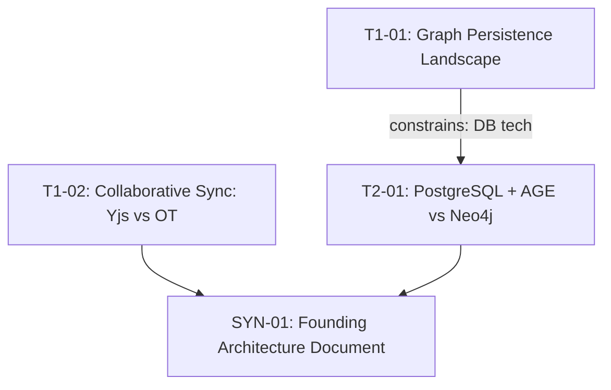

# Sample Adoption Walkthrough: Project Scope (Katha Platform Architecture)

> **Scope:** Project Scope (`ScopeProject`)  
> **Investment:** 4–30 Sessions (Hours–Days)  
> **Overhead:** Full DAG, Mandatory Track A / Track B Phase 0 Gate  
> **Deliverables:** `research/RESEARCH-PIPELINE.md`, `research/DECISIONS.md`, `research/FAD.md` (Founding Architecture)  

> **Note:** This example demonstrates the automated MCP server workflow. For the manual copy-paste workflow without the server, see [`docs/MANUAL-WORKFLOW.md`](../docs/MANUAL-WORKFLOW.md).

This document shows a complete, concrete walkthrough of an AI coding agent applying Vivechak to architect a brand-new system from scratch (**Katha** — an AI-assisted interactive storytelling platform for indie authors). 

Instead of manual copy-pasting, the agent uses Vivechak's orchestration tools autonomously.

---

## Step 1: Initialization & Vision

The agent begins by initializing the workspace for a full project and providing the raw vision in a single call to `vivechak_start`:

**Tool Call:** `vivechak_start`
```json
{
  "scope": "project",
  "question": "We want to build Katha, an interactive web app for indie novelists. Authors write chapters, and the AI maintains a real-time character graph, detects plot inconsistencies, and suggests branching outlines. Needs collaborative editing, persistent story graphs, and low-latency LLM streaming. We have standard EU/US users (GDPR compliance), but no payment data initially. Prefer TypeScript/Next.js for frontend. Unsure about database (graph DB vs Postgres) and sync architecture (Yjs vs WebSocket OT)."
}
```

**Tool Response:**
```json
{
  "success": true,
  "message": "Initialized project scope in ./research. 6 templates copied.",
  "data": {
    "scope": "project",
    "prompt": "# GENERATE: Architectural Pipeline DAG (Project Scope)\n\n## VISION\nWe want to build Katha...\n\n## DEPENDENCY DAG GENERATION\nTopologically decompose into 4-6 focused sessions with explicit inputs/outputs..."
  },
  "next_step": "Synthesize the dependency DAG and persist RESEARCH-PIPELINE.md via vivechak_save(kind=\"plan\")."
}
```

---

## Step 2: The Generated Pipeline

The agent evaluates the generator prompt and produces a 4-session plan: `RESEARCH-PIPELINE.md` and `DECISIONS.md`. 

**Execution DAG (from RESEARCH-PIPELINE.md):**



The agent saves this plan to the workspace.

**Tool Call:** `vivechak_save`
```json
{
  "kind": "plan",
  "id": "DAG",
  "content": "# RESEARCH-PIPELINE.md\n...\n..."
}
```

**Tool Response:**
```json
{
  "success": true,
  "message": "Pipeline saved in research/RESEARCH-PIPELINE.md. 4 sessions detected. DAG is valid. No cycles.",
  "next_step": "Call vivechak_next to get the first actionable session prompt."
}
```

---

## Step 3: Executing Sessions & Context Injection

The agent requests the first actionable session.

**Tool Call:** `vivechak_next`
```json
{}
```

**Tool Response:**
```json
{
  "success": true,
  "message": "Next actionable session: T1-01 (1 parallel ready)",
  "data": {
    "session_id": "T1-01",
    "title": "Graph Persistence Landscape",
    "prompt": "# RESEARCH BRIEF: T1-01 Primary Datastore Selection...\n...",
    "prompt_char_count": 1420,
    "prompt_approx_tokens": 355
  },
  "next_step": "Execute the prompt for session T1-01 in a fresh AI session with web search enabled. Save the result with vivechak_save(kind=\"session\", id=\"T1-01\")."
}
```

The agent executes the research using web search and tool capabilities, producing an analysis of PostgreSQL vs Neo4j. It then saves the session output.

**Tool Call:** `vivechak_save`
```json
{
  "kind": "session",
  "id": "T1-01",
  "content": "---\nsession_id: T1-01\ntitle: Graph Persistence Landscape\ndate: 2026-09-01\nstatus: complete\n---\n\n# T1-01: Graph Persistence Landscape\n\n## Key Findings\n- [Grade A] https://www.postgresql.org/docs/16/queries-with.html PostgreSQL 16 recursive CTEs handle graph traversal up to ~50k nodes at <50ms p95.\n- [Grade B] Internal PGBench runs show minimal CPU overhead with indexed foreign keys.\n- [Grade B] pgvector supports co-located vector search without external index sync.\n\n## Discovered Concerns\nRecursive CTE performance degrades beyond 10 traversal hops without depth limiting.\n\n## Delta\nContradicted initial assumption that dedicated graph database was required.\n\n## Recommendation\nAdopt PostgreSQL 16 with pgvector over Neo4j. Dedicated Graph DB operational overhead is unnecessary at this scale."
}
```

**Tool Response:**
```json
{
  "success": true,
  "message": "Saved research/sessions/T1-01-graph-persistence-landscape.md. Evidence grades valid.",
  "next_step": "Record any resulting decisions with vivechak_record_decision, or call vivechak_next."
}
```

The agent records the primary datastore decision.

**Tool Call:** `vivechak_record_decision`
```json
{
  "decision_id": "D-001",
  "content": "---\nid: D-001\ntitle: Primary Datastore - PostgreSQL 16 with pgvector and Recursive CTEs\nstatus: accepted\ndoor_type: one-way\ndate: 2026-09-01\nhuman_reviewed: true\nevidence_refs: [E-001, E-002]\nreview_trigger: Re-evaluate if graph traversal exceeds 200ms p95 or graph > 500k edges\n---\n\n## Context\nStory graph persistence requires low latency node retrieval with relational metadata.\n\n## Decision\nAdopt PostgreSQL 16 with pgvector extension and recursive CTEs for Katha's story graph persistence. Grade A (https://www.postgresql.org/docs/16/queries-with.html)\n\n## Rejected Alternatives\n- Neo4j: Operational overhead of maintaining a separate cluster with specialized backup procedures is unjustified at 50k nodes.\n- DynamoDB: Multi-hop graph traversals require client-side join logic and costly fan-out queries.\n\n## Evidence\n- [Grade A] https://www.postgresql.org/docs/16/queries-with.html\n- [Grade B] PGBench graph traversal benchmarks at 50k nodes"
}
```

**Tool Response:**
```json
{
  "success": true,
  "message": "Decision D-001 locked. One-way door requires review trigger (provided).",
  "next_step": "Continue pipeline via vivechak_next."
}
```

### Context Injection

When the agent asks for the next session, Vivechak automatically injects the completed T1-01 context into the dependent T2-01 session.

**Tool Call:** `vivechak_next`
```json
{}
```

**Tool Response:**
```json
{
  "success": true,
  "message": "Next actionable session: T2-01 (1 parallel ready)",
  "data": {
    "session_id": "T2-01",
    "title": "PostgreSQL + AGE vs Neo4j",
    "prompt": "# RESEARCH BRIEF: T2-01 PostgreSQL + AGE vs Neo4j...\n...\n## UPSTREAM RESEARCH CONTEXT\n\n## Findings from T1-01\nPostgreSQL 16 is selected...",
    "prompt_char_count": 1850,
    "prompt_approx_tokens": 462
  },
  "next_step": "Execute the prompt for session T2-01 in a fresh AI session with web search enabled. Save the result with vivechak_save(kind=\"session\", id=\"T2-01\")."
}
```

---

## Step 4: Finalizing & The Exit Gate

After completing all sessions, synthesizing the FAD via `vivechak_save(kind="fad", id="SYN-01")`, the agent runs the Phase 0 Exit Gate to ensure the architecture is ready for code:

**Tool Call:** `vivechak_gate`
```json
{
  "track": "all"
}
```

**Tool Response:**
```json
{
  "success": true,
  "message": "Gate evaluation complete.",
  "data": {
    "gate_status": "PASS",
    "gate_passed": true,
    "track_a": {"passed": 5, "issues": []},
    "track_b": {"passed": 7, "issues": []}
  },
  "next_step": "Gate passed. Proceed to implementation using research/FAD.md as architectural source of truth."
}
```

With the Phase 0 Gate passed, the agent uses the sealed FAD as the architectural source of truth and seamlessly transitions into writing the actual Katha application code.

---

## Walkthrough 2: Mid-Project Architectural Decision (Decision Scope)

*Scenario:* Two months into developing Katha, the team hits scaling issues with JSON REST APIs for high-volume character graph syncing. They need an architectural decision: **Should Katha migrate internal service communication to gRPC or stay on HTTP/2 REST?**

This is an architectural decision with lasting impact, but **it does not require a full greenfield FAD or 30-session pipeline**. The agent uses **Decision Scope**:

### Step 1: Start the Decision Scope
**Tool Call:** `vivechak_start`
```json
{
  "scope": "decision",
  "question": "Should Katha migrate internal character graph sync to gRPC or remain on HTTP/2 REST? Node/TypeScript backend; 10k graph mutations/sec; 4 internal microservices."
}
```

**Tool Response:**
```json
{
  "success": true,
  "message": "Decision brief and session plan prepared.",
  "next_step": "Execute the 2 research sessions and save with vivechak_save(kind=\"session\")."
}
```

### Step 2: Save the Decision Plan
**Tool Call:** `vivechak_save`
```json
{
  "kind": "plan",
  "id": "D-015",
  "content": "# Decision Plan: D-015\n| Decision | D-015 |\n| Scope | decision |\n| Door Type | one-way |"
}
```

### Step 3: Execute Focused Sessions & Lock ADR
The agent runs the 2 generated sessions (`L` Landscape and `F` Falsification), saves them via `vivechak_save(kind="session")`, and locks the ADR:
**Tool Call:** `vivechak_record_decision`
```json
{
  "decision_id": "D-015",
  "content": "..."
}
```
*Result:* Canonical ADR `research/decisions/D-015-internal-rpc-protocol.md` is locked with reversal triggers and automatically registered in `research/DECISIONS.md`. **Total time: 25 minutes. Zero project DAG, zero FAD overhead.**

---

## Walkthrough 3: Rapid Technology Comparison (Comparison Scope)

*Scenario:* During a feature sprint, an engineer needs to pick a high-throughput logging library for Katha's Node.js ingestion worker: **Pino vs Winston**.

This is a bounded library evaluation. Building a DAG or running a Phase 0 Gate would be absurd bureaucracy. The agent uses **Comparison Scope**:

### Step 1: Start the Comparison Scope
**Tool Call:** `vivechak_start`
```json
{
  "scope": "comparison",
  "question": "Pino vs Winston for Node.js 22 worker ingesting 15k events/sec with AWS CloudWatch export"
}
```

**Tool Response:**
```json
{
  "success": true,
  "message": "Prepared comparison brief.",
  "next_step": "Execute research with web search and save WEP comparison matrix with vivechak_save(kind=\"comparison\", id=\"C-001\")."
}
```

### Step 2: Execute Research & Save Output
The agent executes the self-contained prompt with web search. The model returns an evidence-graded Weighted Evaluation Protocol (WEP) matrix with sensitivity analysis (±20% weight shifts) and concrete failure modes.

The agent persists the result directly:
**Tool Call:** `vivechak_save`
```json
{
  "kind": "comparison",
  "id": "C-001",
  "content": "# COMPARISON: Pino vs Winston for High-Throughput Ingestion\n..."
}
```
*Result:* Output is saved to `research/comparisons/C-001.md`. The engineer has an authoritative, evidence-graded recommendation based on primary benchmarks. **Total time: 4 minutes. Zero DAG, zero templates copied, zero gate required.**
