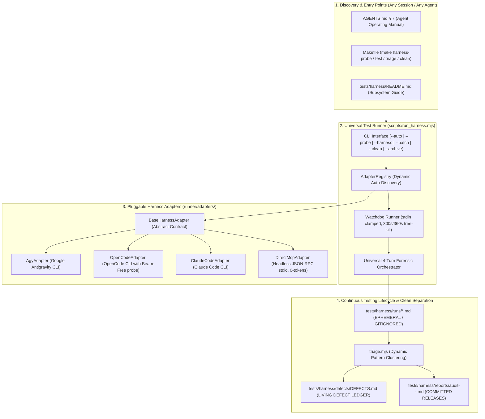

# Vivechak Autonomous Multi-Harness Testing Subsystem
### Empirical Multi-Agent Stress-Testing, Automated Watchdogs & Epistemic Hardening

This directory contains Vivechak's **Autonomous Multi-Harness Testing Engine (AHTE)**. It subjects Vivechak to rigorous, zero-trust autonomous stress-testing across diverse AI agent host CLIs, models, and headless MCP clients.

---

## 1. Architecture & Mental Model



---

## 2. Directory Layout & Roles

| Path | Purpose | Git Status |
|---|---|---|
| `SCENARIOS.md` | 21 human-realistic test scenarios with messy typos, cross-domain problems, and checklists. | Committed |
| `TEST-PLAN.md` | Theoretical methodology and zero-trust testing philosophy. | Committed |
| `runner/` | Standalone engine: watchdog, orchestrator, triage, types, and pluggable adapters. | Committed |
| `runner/adapters/` | Modular adapter definitions (`direct_mcp`, `agy`, `opencode`, `claude_code`). | Committed |
| `reports/` | Immutable milestone audit reports compiled at major release points (e.g. `audit-v0.1.0-2026-10-19.md`). | Committed |
| `defects/` | Living defect and polish ledger (`DEFECTS.md`) tracking discovered bugs, root causes, and fixes. | Committed |
| `runs/` | Local ephemeral test outputs and conversation logs. | **Strictly Gitignored** (`.gitkeep` preserved) |

---

## 3. Quickstart & Command Reference

### ⚠️ Branch Isolation Policy (Protecting `main`)
Always execute autonomous testing campaigns, iterative defect logging, and candidate bug fixes on a dedicated branch (e.g. `audit/harness-testing`). **Never run testing campaigns directly on `main`**:
```bash
# Create and switch to a testing branch before launching tests
git checkout -b audit/harness-testing
```
Only merge back into `main` after all scenarios pass and `make release-check` passes cleanly.

### Run Pre-Flight Health & Quota Probes
Checks all registered harnesses in parallel for binary presence, auth status, and active credit quota:
```bash
make harness-probe
# or: node scripts/run_harness.mjs --probe
```

### Auto-Run on All Available & Funded Harnesses
Automatically runs tests only across harnesses that are currently available and have active quota:
```bash
make harness-test
# or: node scripts/run_harness.mjs --auto --batch core
```

### Run Zero-Token Headless MCP Conformance Test
Tests all Vivechak tools deterministically over stdio JSON-RPC without requiring internet or AI credits:
```bash
node scripts/run_harness.mjs --harness direct_mcp --scenario 01
```

### Target a Specific Harness & Scenario
```bash
node scripts/run_harness.mjs --harness opencode --scenario 01,02,04
node scripts/run_harness.mjs --harness agy --batch all
```

### Run Dynamic Triage
Parses all active runs in `runs/`, calculates pass/fail rates, clusters Turn 4 feedback, and prints the scorecard:
```bash
make harness-triage
# or: node scripts/run_harness.mjs --triage
```

### Clean Ephemeral Runs & Sandboxes
Resets the local testbed to prepare for a fresh testing cycle:
```bash
# Clean ephemeral test run markdown files in tests/harness/runs/
make harness-clean
# or: node scripts/run_harness.mjs --clean

# Clean isolated workspace sandboxes from OS temp directory
make harness-clean-sandboxes
# or: node scripts/run_harness.mjs --clean-sandboxes
```

### Archive Release Milestone Audit
Compiles current runs into an immutable release report in `reports/` and resets the testbed:
```bash
node scripts/run_harness.mjs --archive v0.1.0
```

---

## 4. Model Selection, Free Tiers & Fallback Cascades

The test runner supports overriding models per harness and provides automatic failover cascades across adapters (`opencode`, `agy`, `claude_code`) if credits, quotas, or rate limits are encountered.

### OpenCode Free Model Lineup:
| Model ID | Provider | Context | Best Use Case |
|---|---|:---:|---|
| `opencode/beam-free` *(Default)* | OpenCode Zen | **1M** | Fastest execution, low congestion, default for batch testing |
| `opencode/big-pickle` | Stealth (GLM-5) | 200K | High-quality Markdown prose, natural ADR synthesis |
| `opencode/nemotron-3.5-lightning-free` | NVIDIA | **1M** | Hybrid Mamba-2; massive context stability for large repos |
| `opencode/glm-5.3-flash-free` | Zhipu AI | 200K | Heavy-duty logical reasoning and complex DAG replanning |
| `opencode/space-bunny-free` | Stealth | 128K | Aggressive terminal tool-calling and active file edits |

### Overriding the Target Model:
Pass the `--model` flag to target any model:
```bash
# Run with Big Pickle
node scripts/run_harness.mjs --harness opencode --model opencode/big-pickle --scenario 01

# Run with NVIDIA Nemotron
node scripts/run_harness.mjs --harness opencode --model opencode/nemotron-3.5-lightning-free --scenario 03
```

### Automatic Model Failover Cascades:
All AI adapters inherit automatic failover logic from `BaseHarnessAdapter`.
- **OpenCode cascade:** `beam-free` → `big-pickle` → `nemotron-3.5-lightning-free` → `glm-5.3-flash-free` → `space-bunny-free`.
- **Antigravity cascade:** `gemini-3.8-flash-high` → `gemini-3.8-flash` → `claude-sonnet-4-6`.
- **Claude Code cascade:** `claude-3-5-sonnet` → `claude-3-5-haiku`.

If a model encounters credit exhaustion or quota limits during pre-flight probe or mid-test execution, the runner automatically detects the failure, logs `[MODEL_FAILOVER]`, switches to the next healthy model, and retries the turn without failing the test run.

### Dead-Session Short-Circuiting:
If Turn 1 aborts, times out, or produces zero output, `orchestrator.mjs` marks the session as `TURN1_FAIL` and immediately short-circuits Turns 2–4. This avoids wasting up to 270 seconds on an already-dead process tree while still assembling the partial diagnostic report.

### Full 21-Scenario Semantic Triage:
`triage.mjs` implements scenario-specific semantic evaluation across all 21 scenarios, verifying the exact required invariants (e.g. WEP matrices for 01/02, ADRs for 04/05/10, DAG pipelines for 03/06, `vck challenge` for 08, `vck amend` for 09, `vck replan` for 11, `vck gate` for 12/17, `vck status` for 13, `vck validate` for 14, `vck setup` for 19, `vck doctor` for 20, and anti-pattern code authoring guardrails for 21) without false-negative file-existence failures.

---

## 5. The 4-Turn Forensic Protocol

Every test run executes in a pristine, isolated sandbox workspace (`os.tmpdir()/vivechak-sandboxes/s-<id>-<harness>-<timestamp>`) across 4 standardized turns:
1. **Turn 1 (Scenario Prompt):** Human-realistic unprompted request (with typos/slang).
2. **Turn 2 (Forensic Debrief):** Model debriefs tools called, arguments passed, workspace state, and `next_step`.
3. **Turn 3 (Comparative Reflection):** Model compares answering with Vivechak vs. pure parametric memory.
4. **Turn 4 (Meta-Improvement Probe):** Elicits feedback on DX friction, schema ambiguity, and file ergonomics.

---

## 6. Adding a New Harness Adapter

To add a new AI agent CLI or MCP client (e.g. `cursor`, `windsurf`, `cline`, or a custom swarm):
1. Create `tests/harness/runner/adapters/<name>.mjs` extending `BaseHarnessAdapter`.
2. Implement:
   - `probe()`: checks binary, auth, and token/quota health.
   - `runTurn(prompt, sandboxDir, model, timeoutMs)`: starts a new session.
   - `continueTurn(prompt, sandboxDir, timeoutMs)`: continues the session in the existing sandbox.
3. Register the new adapter in `tests/harness/runner/adapters/registry.mjs`.
4. Run `node scripts/run_harness.mjs --probe` to verify detection.

