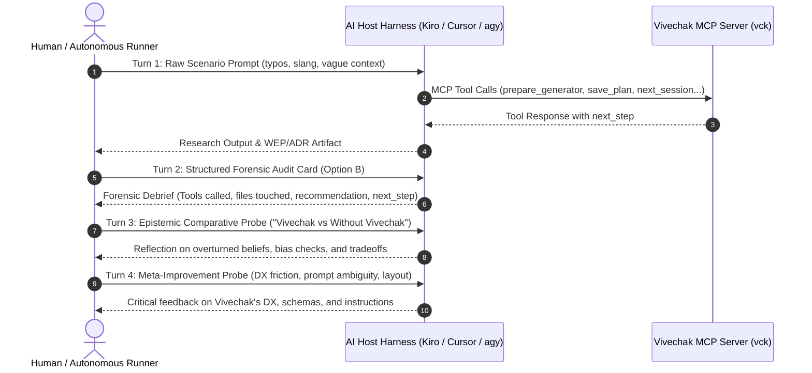

# Vivechak Zero-Trust Empirical Stress Testing & Hardening Plan
### Comprehensive Protocol for AI Host Harnesses, Small Models & Epistemic Correctness
**Branch:** `audit/harness-testing` · **Target Release:** `v0.1.0` · **Standard:** Zero-Trust Falsification

---

## 1. Objective & Philosophy

Vivechak is an epistemic grounding framework for AI agents. If the framework itself is flawed, ambiguous, or fragile, every downstream technical decision made by teams using it is compromised.

This testing plan is governed by **Zero-Trust Falsification (Principle P8)**:
1. **Zero Sycophancy:** We do not celebrate passes; we actively search for edge cases, prompt ambiguities, parameter friction, and model failure modes.
2. **Total Isolation:** Every scenario run MUST execute in a completely fresh, isolated scratch workspace with zero memory bleed, zero prior context, and no shared state.
3. **Small-Model Stress:** Testing is calibrated against small/fast models (`gemini-3.8-flash`, `gpt-4o-mini`, `claude-3.5-haiku`, `qwen-2.5-coder`) because their high susceptibility to hallucination and strict schema adherence exposes flaws that large frontier models silently work around.
4. **Root-Cause Traceability:** Every observed symptom must be traced directly to lines of code in `internal/mcp/`, `internal/core/`, or `GENERATOR-*.md` prompts.

---

## 2. The 4-Turn Universal Session Protocol

Every scenario must execute across four standardized conversational turns to capture execution data, forensic state, epistemic value, and meta-improvements:



### Turn 1: Raw Scenario Prompt
Pasted from [`tests/harness/SCENARIOS.md`](SCENARIOS.md). Deliberately unpolished with human typos, slang, missing parameters, and cross-domain requirements.

### Turn 2: Structured Forensic Audit Card
```text
Give me a concise debrief of your actions:
1. Tools Called: List each tool name called and key arguments passed (including aliases).
2. Workspace State: List all files/folders created, modified, or confirmed untouched.
3. Final Outcome: State the recommendation, decision, or artifact generated.
4. Next Step: What did Vivechak's next_step field recommend doing next?
```

### Turn 3: "Vivechak vs. Without Vivechak" Epistemic Reflection
```text
Reflect on this session: Compare how you answered this question using Vivechak versus how you would have answered it without Vivechak (from pure parametric memory). What specific errors, ungrounded assumptions, or blind spots did the research catch or overturn? What are the honest tradeoffs (speed, token cost, rigor)?
```

### Turn 4: Meta-Improvement Probe
```text
Based on your execution experience in this session, suggest all potential improvements to Vivechak:
1. DX Friction: Were any tool parameters confusing, redundant, or missing aliases?
2. Prompt / Guidance Ambiguity: Did any instructions in the generator brief or next_step cause hesitation or sub-optimal formatting?
3. File & Artifact Layout: Could the generated markdown artifacts or directory structure be cleaner or more ergonomic?
```

---

## 3. The 21-Scenario Matrix & Invariant Checklist

| Scenario | Scope | Target MCP Tool & Key Feature | Primary Invariant to Verify |
|---|---|---|---|
| **01** | Comparison | `vivechak_prepare_generator(scope="comparison")` | Auto-inferred comparison scope, 0 DAG, 0 gate, WEP matrix generated |
| **02** | Comparison | `vivechak_save_plan` (skipped init) | On-the-fly auto-init, auto-recovers ID, writes `research/.gitignore` (`*.lock`) |
| **03** | Project | `vivechak_next_session` | DAG traversal, upstream context injection, respects draft status |
| **04** | Decision | `vivechak_prepare_generator(scope="decision")` | Profiles Two-Way Door ($R=1$), routes to 1-session Fast Spike ADR |
| **05** | Decision | `vivechak_prepare_generator(scope="decision")` | Profiles One-Way Door ($R=3, X=3$), routes to Deep Research (L, C, F) |
| **06** | Project | `vivechak_prepare_generator(scope="project")` | Multi-tier DAG in `RESEARCH-PIPELINE.md`, disentangles metadata tables |
| **07** | Project | `vivechak_save_session` | Non-blocking `Q-*` coaching in `next_step`, 50-char concern gate |
| **08** | Decision | `vivechak_challenge` | Aliases (`decision_id`, `premortem`), two-tier lookup in `research/` |
| **09** | Decision | `vivechak_amend_session` | Aliases (`content`, `reason`), two-tier lookup, auto-recompiles `DECISIONS.md` |
| **10** | Decision | `vivechak_record_decision` | Canonical ADR `D-*.md` compiled into consolidated `DECISIONS.md` |
| **11** | Project | `vivechak_replan` | Guided overview mode or updates DAG dependencies with `reason` and `impact` |
| **12** | Project | `vivechak_run_gate` & `vck gate` | Active track filtering (`track_a` vs `track_b`), decoupled Two-Way Door pass |
| **13** | All | `vivechak_status` & `vivechak_visualize` | Scope-aware session accounting, terminal completion `next_step`, Mermaid |
| **14** | All | `vivechak_validate` | Workspace mode auto-discovers sessions, plans, ADRs, comparisons, FAD |
| **15** | Project | `vivechak_save_session` (AST Code Fence) | CommonMark `FenceTracker` ignores `#` inside code blocks |
| **16** | All | `InferScope` via `vck` prefixes | CLI command prefixes (`vck compare`, `vck decide`, `vck plan`) route scope |
| **17** | All | Dual-Source Decision Scanner | Scans both `D-*.md` and `DECISIONS.md` concurrently with ID deduplication |
| **18** | Project | `core.ObserveSessionQuality` | Cross-references URLs in ledger tables, parses `[Grade: A]` colon syntax |
| **19** | System | `vck setup` (21 presets) & `vck mcp-config` | Number-preserving JSON merge across 21 IDE/CLI presets |
| **20** | System | `vck doctor` | Audits workspace layout, frontmatter, orphan detection, and scope detection |
| **21** | Boundary | Zero Tool Calls (Anti-Pattern Guardrail) | Directly writes code / diagnoses bugs without invoking Vivechak |

---

## 4. Defect Categorization & Severity Scale

Every defect discovered during testing is logged in [`audit_defects_and_polish.md`](audit_defects_and_polish.md) using this taxonomy:

* **Category:**
  - `CAT-TOOL`: Tool parameter naming, alias support, jsonschema descriptions, return envelope data.
  - `CAT-PROMPT`: Generator prompt ambiguity, slot defaults (e.g. `default D-NEW`), missing formatting constraints.
  - `CAT-ENGINE`: Server logic, AST fence tracking, atomic writes, locking, DAG cycle checks, gate decoupling.
  - `CAT-DX`: Human/model ergonomics, clarity of `next_step`, error messages, CLI flags.
* **Severity:**
  - `CRITICAL`: Blocks session execution, causes data corruption, or creates an infinite loop.
  - `HIGH`: Causes wrong scope inference, missing gate checks, or file split-brain.
  - `MEDIUM`: Generates sub-optimal artifacts, trips false-positive warnings, or causes argument retry.
  - `LOW`: Cosmetic naming convention divergence, minor presentation differences.

---

## 5. The Iterative Hardening Flywheel

```
[Execute Scenario in Isolation]
              │
              ▼
    [Ingest 4-Turn Report]
              │
              ▼
   [Forensic Audit & Trace]
              │
              ▼
 [Log Defect & Root Cause in Log]
              │
              ▼
 [Patch Go Code / Generator Prompts]
              │
              ▼
   [Run CI & Embed-Sync Tests]
              │
              ▼
[Re-test Scenario & Confirm Resolution]
              │
              ▼
  [Advance to Next Scenario]
```

When all 21 scenarios pass with zero unmitigated defects:
1. Compile the **Grand Harness Audit Certification Report**.
2. Run full test suite: `make release-check` (`vet`, `lint`, `test`, `embed-sync`).
3. Merge verified improvements into `main` with 100/100 standard.
